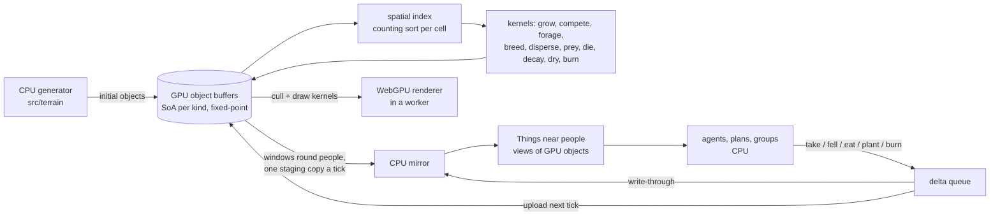

# refactor: GPU-resident per-object world (WebGPU in Bun and the browser)

## Overview

Every living and lying thing on the island becomes an individual object simulated on the GPU: each stem, seedling, log, stick, stone, deer, rabbit, wolf, fox, bird and fish, at the densities measured in the field. Their state lives in GPU buffers, their laws run as WebGPU compute kernels in fixed-point integer arithmetic, and the renderer draws them straight from those buffers. People and their minds stay on the CPU; the objects near them are mirrored back each tick so agents see, take, fell and eat real individuals.

No approximation stands in for anything: the island holds about 10 million stems, 10^8 seedlings, 2 x 10^8 sticks, billions of stones, 10^11 grass tillers, 10^10 and more leaves and twigs, and 10^10 to 10^13 insects and soil animals, and every one of them is an individual with an identity. Measured on the dev GPU, brute-force storage tops out near 1 to 3 x 10^9 individuals (4 GB of VRAM is the limit, not compute), so each kind takes the cheapest of five exact representations:

- **Active:** stored and stepped every tick its laws need (stems, animals, fish). Pathwise exact.
- **Event-driven:** stored, but stepped only when its next event falls due, its waiting times drawn exactly in integers and thinned when hazards change (seedlings, anything whose state changes only at events). Pathwise exact; measured 35.6 ms a simulated day for 5.4 x 10^8 individuals.
- **Dormant:** state computed exactly on demand from identity, birth and recorded per-cell drivers; stored only once touched (logs, sticks, stones; sand at 0 bytes). Pathwise exact.
- **Streamed:** short lives evaluated one by one in a kernel, survivors stored (seeds). Pathwise exact.
- **Lumped:** where a kind outruns memory (grass tillers, small litter, insects, soil fauna, moving sand), individuals sharing a cell and an identical integer state are held as a count, each tick's fates drawn by exact integer binomial and multinomial samplers (a sublinear sampler after Bringmann et al. 2014 ran at up to 5 x 10^12 fates a second, bit-identical on both GPUs), and any member's identity, birth and fate recoverable on demand through a seeded permutation. The cited laws for these kinds act on per-square-metre or per-plant shared inputs plus each individual's own state (tiller density per m², litter pools, insects per unit habitat), so lumping at that scale is the same stochastic process the law defines, exact in distribution; a member a world event singles out (a bird takes this beetle) is promoted to a full individual. Bins degenerate into plain individuals wherever states are diverse, automatically.

A test proves each event-driven, dormant and streamed kind bit-equal to stepping it as active, and each lumped kind equal in distribution (exact sampler tests and equality of the count chain).

The game must also run better than today: no stutter when zooming, panning or rotating the island. Today's lag comes from CPU work in the renderer (bake workers rasterize terrain and objects into chunks per level and bearing, and only eight chunk uploads fit a frame); the WebGPU renderer rasterizes everything on the GPU, so a zoom or a turn costs GPU time inside the frame and no CPU baking at all.

This replaces the population approximations built so far (`src/sim/herds.ts` per-tile densities, `src/sim/fish.ts` stocks, `src/sim/recruits.ts` cohorts) with per-object simulation, as the operator asked, and lands substrate 11's measured densities (real stems, per-piece deadwood) that per-object JavaScript cannot carry.

WebGPU runs headless under Bun through Google's Dawn bindings (`webgpu` npm), inside `bun test`, bit-identical to headless Chrome on the same GPU, and integer kernels were bit-identical across both GPUs of the dev machine and JavaScript. One WGSL codebase serves the play page and the gates.

## Problem Frame

- Substrate 11 found real stem density ~10x and deadwood 1 to 3 orders of magnitude above what the generator lays (docs/research/generator/2026-10-14-flora.md); the operator chose real stems and per-piece deadwood, and GPU use everywhere.
- The generator already lays 3.3 million things (870,000 trees) on seed 1, kept as packed typed arrays (`src/terrain/flora.ts` `Scatter`) and materialized as JavaScript `Thing`s per touched tile (`src/sim/space.ts`). Animals and young plants are densities and cohorts, not individuals; animals are "revealed" out of densities near people.
- The play page runs sim and renderer on the main thread (`demo/styles/play/main.js`); the renderer bakes objects into art chunks on CPU workers (`demo/styles/isopixel/bake.js`, `things.js`); WebGL2 instancing is used once (`gpu.js`, shadow rows). No WebGPU exists.
- Zooming, panning and rotating stutter today: a new level or bearing needs chunks baked on CPU workers (`bake.js` rasterizes 256x256 terrain-and-object chunks; `gpu.js` uploads at most 8 a frame), so the view waits on the CPU.
- `tick(w)` is synchronous everywhere (`src/sim/sim.ts`, `server.ts`, `scripts/run.ts`, `scripts/bench.ts`, `scripts/probes.ts`, `demo/styles/play/sim.js`, several tests); GPU readback is asynchronous.

## Requirements Trace

**World model**
- R1. Every thing on the island (plants, seedlings, seeds, grass tillers, deadwood and litter, stones and sand, animals, insects and soil fauna, fish) is an individual at measured density with its own identity and state, held in one of the five exact representations in Capacity and Representation; nothing is a density, an approximate cohort or a revealed stand-in.
- R2. The object an agent sees, takes, fells or eats is the object the GPU simulates and draws: one identity, one state.
- R3. Population behaviour (growth, competition, reproduction, dispersal, foraging, predation, death, decay) emerges from per-object laws; the density and cohort approximations are removed.

**Compute**
- R4. Those laws run as WebGPU compute in fixed-point integer arithmetic, including their transcendental terms, so results are reproducible on any GPU and equal to TypeScript oracles.

**Platform and harness**
- R5. `bun test`, `scripts/probes.ts`, `scripts/evals.ts`, `scripts/run.ts`, `scripts/bench.ts` and `server.ts` run the same kernels headless under Bun and stay reproducible for a seed.
- R6. The play page requires WebGPU (Chrome/Edge 113+, Safari 26); no WebGL2 or CPU fallback is kept.

**Renderer**
- R7. The renderer draws every object from the GPU buffers at interactive frame rates (GPU culling, indirect draws), keeping the isometric pixel-art look and its depth and anchor invariants.
- R9. Zooming, panning and rotating never stutter: on the dev machine no frame exceeds 16.7 ms during the page's `?bench=zoom`, `orbit`, `turn` and `pan` runs at default settings, and the renderer does no CPU rasterization.

**House rule**
- R8. Every physical constant moved or introduced is cited, [derived], [design] or [gap]; nothing is retuned to pass a check, and the world must still play: scarcity of food and fuel stays meaningful at real densities.

## Scope Boundaries

- People's minds (`src/sim/brain.ts`, `beliefs.ts`, `groups.ts`, planning in `sim.ts`) stay on the CPU.
- The terrain generator (`src/terrain/*`) stays on the CPU; it runs once an island and writes the initial object buffers. Substrate 11's generator laws (climate, rock and erosion, water, ground, niche; docs/research/generator/2026-10-14-*.md) land there independently of this plan.
- No CPU runtime fallback: the TypeScript code that mirrors each kernel exists only as a test oracle (single-step functions in the unit's test file) plus golden checksums for long runs.
- Cross-machine float reproducibility is not needed because gate-relevant arithmetic is integer.

### Deferred to Separate Tasks

- The Bornholm sky (branch `wip/bornholm-sky`): finish on the CPU after Phase A, re-deriving on the game's solar-centred season windows.
- Substrates 6, 7, 8, 9, 12 (walking, work as energy, shelters, hunting and fishing, perception) follow once objects are on the GPU, since they read them.

## Context & Research

### Relevant Code and Patterns

- Systems being replaced: `src/sim/herds.ts` (per-tile `number[]` populations over the 128x128 tile grid, summed-area `box()`, `shared()` predator allocation, `groundFor(w)` static typed arrays), `src/sim/fish.ts` (per-water-tile stocks, animals revealed near people), `src/sim/recruits.ts` (cohorts per stocked tile), `src/sim/plants.ts` and `src/sim/seedling.ts` (growth law and the hourly seedling step), `src/sim/animals.ts` (individual wolves and revealed animals).
- Materialization and identity today: `src/sim/space.ts` (`stock`, `shelve`, `objects`, `around`, `nearestThing`, `lookAround`, `regrow` and its `taken` map), `src/sim/world.ts` (`grown(w, k)`, `HP`, `VERSION`), `src/terrain/flora.ts` (`Scatter`, `FLORA`, `SPECIES`); grid `src/terrain/grid.ts` (N 256, CELL 75 m, TILE_CELLS 2), `TILE_M` 150 m and `TILES` 128 in `flora.ts`.
- Light and canopy: `src/sim/light.ts` (`crownsAt`, `crownRadius`), `src/terrain/growth.ts` (`sieve`/`through`, the two-crown cap), `demo/styles/isopixel/canopy.js` (renderer twin).
- Moisture: `src/sim/wetness.ts` keeps an island reference per thickness (`dead`) and per-Thing paths (`carried`, `laid`); there is no per-cell moisture grid today.
- Renderer: `demo/styles/isopixel/gpu.js`, `live.js`, `bake.js`, `things.js`, `px.js` (`ObjBins` built from `objects().grown`), `demo/styles/isopixel/main.js` (`collectLive`).
- Determinism: `scripts/seeded.ts` (seeded `Math.random`, about 70 call sites), `scripts/bench.ts` checksums, `src/sim/fire.test.ts` seeded replay, `src/sim/world.ts` note that an optimized sort once broke replay; `scripts/evals.ts` sizes jobs by system memory (about 1.25 GB a probe, 2 GB a world).
- Persistence: `server.ts` saves `JSON.stringify(w)` every 50 ticks and reloads it.
- Constraints in `.claude/napkin.md`: never iterate all things on the CPU; frames come from resident chunks; depth `z = 1.5H(u+v) + lev·lp` and anchor invariants.

### Baseline (seed 1, dev machine, current code)

- Smoke run `NOMADS_BRAIN=random scripts/run.ts --ticks 864`: tickMs animals 3.8 to 4.3, ecology 4.4 to 6.9 (machine under load), agents 0.3 to 0.8; deer 1,325, rabbits about 31,800, wolves 14, foxes 168.
- One probe batch (`/tmp`-local batch of seed/two s3) 73 to 140 s depending on load.
- These numbers are re-measured at the start of Phase B on an idle machine and recorded in this plan before any kernel lands.

### External References

- Dawn Node bindings, `webgpu` npm 0.6.2, run under Bun and `bun test` (tested on this Mac): https://github.com/dawn-gpu/node-webgpu
- Bun has no built-in WebGPU (issue 7380): https://github.com/oven-sh/bun/issues/7380
- WGSL float latitude (reassociation, fusion, flush-to-zero) and integer wraparound: https://www.w3.org/TR/WGSL/ sec. 15.7
- Async, whole-buffer readback (gpuweb issue 1972): https://github.com/gpuweb/gpuweb/issues/1972
- Counter-based RNG for reproducible GPU cellular models (Philox): https://arxiv.org/html/1701.03549v2
- Determinism levels in practice: https://developer.nvidia.com/blog/controlling-floating-point-determinism-in-nvidia-cccl
- WebGPU browser support (Chrome 113+, Safari 26; Firefox on Intel Macs pending): https://web.dev/blog/webgpu-supported-major-browsers
- Measured on the dev machine (AMD Radeon Pro 5500M): a 1M-element, 64-step float kernel 1,866 ms in JS against 8 to 12 ms on WebGPU including an 8 MB readback; integer kernels bit-identical across the AMD and Intel GPUs and JS; small readback p50 0.11 to 0.15 ms.

## Capacity and Representation

Counts on seed 1 (22,217 ha of land: 10,886 ha of tree cover, 2,081 shrub, 3,638 grass, 1,195 marsh) at the densities in docs/research/generator/2026-10-14-flora.md and the plant and animal constants, against the dev GPU's 4 GB and 192 GB/s and the machine's 16 GB of RAM. Counts are [INFERENCE] from cited densities until Unit 4 measures them.

| Kind | Density | Count on the island | State changes by | Representation |
|---|---|---|---|---|
| Tree stems | 600 to 1,200/ha closed wood | 7 to 13 million | growth, competition, damage | active |
| Tree seedlings and saplings | 10^3 to 10^4/ha standing | 10^7 to 10^8 | growth, browsing, shade | active |
| Seeds in flight and on the ground | 10^4 to 10^5 per tree a year | 10^10 to 10^11 a year | dispersal, predation, emergence | streamed: each evaluated, survivors stored |
| Shrubs (bramble, hazel, heather plants) | 10^3 to 10^5/ha | 10^7 to 10^8 | growth, browsing | active or event-driven |
| Herbs, ferns, flowers, reed shoots | 10^4 to 10^6/ha | 10^8 to 10^9 | growth, grazing, season | event-driven, lumped where a cell's members share state |
| Grass tillers | ~10^7/ha | ~10^11 | birth, growth class, defoliation, death | lumped by (cell, integer state), identity on demand |
| Leaves and twigs under 1 cm | 10^5 to 10^7/ha | 10^10 and up | fall, decay, fragmentation | lumped, decay dormant from recorded drivers |
| Insects and soil fauna | 10^6 to 10^9/ha | 10^10 to 10^13 | stage, growth, predation, death | lumped by (cell, taxon, stage, integer state); promoted when singled out |
| Logs (10 cm and up) | 48 to 154 m³/ha unmanaged | 10^6 to 10^7 | decay, moisture, fire | dormant until touched |
| Sticks (1 to 10 cm) | ~17,000/ha | ~2 x 10^8 | decay, moisture, fire | dormant until touched |
| Boulders, stones, pebbles (2 cm and up) | till power law d^-2.9 | 10^9 to 10^10 | nothing unless moved | dormant (static): stored only once moved |
| Sand and fine gravel | per bed | astronomical | nothing unless moved | dormant (static) by hash at 0 bytes; moved sand lumped by size class |
| Deer, rabbits, wolves, foxes, small mammals, birds | measured densities | 10^5 to 10^6 | every law | active |
| Fish | measured biomass | 10^5 to 10^6 | every law | active |

What the representations cost (measured on the dev GPU): an active individual 4 to 32 bytes; event-driven 2 to 4 bytes; dormant 0 to 8 bytes; a streamed seed nothing unless it survives; a lumped bin 8 bytes (16 double-buffered) for any number of members, worth it from about 80 members a bin. Brute-force stepping runs about 5 x 10^9 simple individual updates a second; the exact samplers run 10^11 to 10^15 fates a second depending on bin size. The table fits in 4 GB with active and event-driven kinds near 1 to 2 GB and lumped kinds in a few hundred MB.

There is no floor: everything is an individual. What differs by kind is only whether its randomness is keyed per individual (pathwise exact) or per bin (exact in distribution relative to a law that reads shared per-area inputs). Individual-scale laws finer than the cited ones (centimetre competition between tillers, continuous per-tiller size noise at 16-bit resolution) would collapse bins into individuals and exceed memory; none of the cited laws needs them.

## Key Technical Decisions

- **Three exact representations of one object kind.** Active (stored, stepped), dormant (state computed exactly on demand from identity, birth and recorded drivers; promoted to active when touched, burned, eaten or moved) and streamed (short lives evaluated one by one in a kernel, survivors stored). Rationale: R1 at hundreds of millions to billions of objects without approximation; equality with active stepping is tested per kind.
- **Event-driven stepping where state changes only at events.** Exact integer geometric waiting times (bitwise Bernoulli digits) with thinning for hazards that change with the drivers; a scan-and-compact pass gathers the individuals due each day. Rationale: pathwise exact at a fraction of per-tick cost.
- **Lumped individuals with recoverable identity.** Per (cell, integer state) bins; exact multinomial splits over a law's dyadic outcome intervals; bit-sliced binomials for small bins and a sublinear exact sampler (Bringmann et al. 2014 rejection with Karney's exact exponential, integer bounds, and an exact slow path for the rare ambiguous case) for large ones; identity by a seeded Feistel permutation per bin with cycle-walking; promotion to a full individual when a world event singles one out; observation is read-only. Rationale: exactness relative to per-area laws at 10^10 to 10^13 members.
- **Root the GPU instance for the device's life.** dawn.node frees its instance when the JavaScript `GPU` object is collected while work is pending (a segfault under Bun and Node alike); the device layer ties the instance to the device. Measured: 100 of 100 runs clean under Bun, Bun workers, `bun test` and Node with the fix, 0 of 100 without.
- **Recorded drivers make dormancy exact.** The per-cell drivers a dormant object's laws read (hourly air, rain, canopy over it, fire passes) are recorded as compact per-cell histories on the GPU, so a log's moisture and decay at any hour equal what stepping it hourly would give. Rationale: dormancy must not be an approximation.

- **Per-object state on the GPU, structure of arrays per kind.** Each kind (stems, seedlings, logs, sticks, clasts, low plants, each animal kind, fish) is a set of parallel GPU buffers indexed by object id. Rationale: R1 to R3; the operator wants individuals, not densities.
- **Integer arithmetic end to end in gate kernels.** Gate-relevant state and the arithmetic producing it are fixed-point integers with a documented unit and scale per buffer; exp, log, fractional powers, gamma and lnGamma come from shared fixed-point routines with WGSL and TypeScript twins. No float appears between a buffer read and a buffer write in a gate kernel; float is allowed only in drawing. Rationale: R4; floats differed across GPUs from the 6th digit, integers didn't.
- **Counter-based randomness.** Every draw is a pure hash of (world seed, stream, object id, tick); distributions (uniform, normal, Poisson, exponential, gamma, lognormal, binomial, Weibull quantile) are fixed-point functions of it. CPU-side agent logic keeps the seeded `Math.random`. Rationale: order-free, reproducible, testable against twins.
- **Deterministic allocation.** Births and spawns are counted per parent, turned into indices by an exclusive prefix sum in parent-id order, and written to a free list or the buffer's tail; deaths set a dead flag and free indices are recycled in index order at a fixed point in the tick. Compaction, when needed, is a stable prefix-sum pass. Rationale: same ids every run, no atomic-order dependence.
- **Deterministic contention.** When several objects want one resource (two deer one shoot, two wolves one deer), claims are resolved by a fixed rule (lowest id wins, or a hashed priority) in a two-pass claim/resolve kernel. No float atomics; integer `atomicMin`/`atomicAdd` only where the result is order-free.
- **Spatial index on the GPU.** A counting sort of objects into 75 m cells each tick (stable by id) gives neighbour queries for competition, foraging, predation and crowns. Rationale: per-object laws need neighbours.
- **Identity is the object id.** A `Thing` near people is a view of a GPU object, its id derived from (kind, index, generation) so a recycled index never aliases an old reference. Growth never changes identity. Rationale: R2; resolves the review's identity-triple concerns.
- **Write-through mirror, async tick.** `tick(w)` becomes async: upload the queued deltas, run due kernels, copy the windows around people to a staging ring and await the map at the end of the tick. Deltas an agent queues are applied to the CPU mirror at once (the agent and the next frame see their own felling) and reach GPU state at the next kernel run; everything else in the mirror is at most one tick old. Every caller of `tick` awaits it.
- **Twins as single-step oracles plus golden checksums.** Each kernel has a TypeScript single-step oracle in its test file; long runs are checked against recorded golden checksums. Any rule change lands in the WGSL kernel and its oracle in the same commit: this doubled implementation is the accepted cost of the GPU-first sim.
- **Save and load read back the world.** `server.ts` save reads back every resident buffer once and serializes it with `w` (bumping `VERSION`); load uploads them instead of regenerating. Rationale: GPU state is invisible to `JSON.stringify`.
- **Pin the adapter in headless runs; bound eval concurrency by GPU memory.** Evals and tests choose the adapter explicitly and record it in ledgers; `scripts/evals.ts` limits concurrent children by adapter memory over the measured per-world buffer size as well as by RAM.
- **Generator stays CPU, writes initial buffers.** Rationale: once per island; flood and receiver ordering are sequential.
- **WebGPU required in the browser; the renderer moves to WebGPU inside a worker with OffscreenCanvas.** A `GPUDevice` can't be shared across realms, so the renderer and (later) the sim share one worker. The WebGL2 path is deleted after pixel parity is shown against frames captured before the world changes.

## Open Questions

### Resolved During Planning

- No floor of individuality: every thing is an individual; the representation per kind is one of the five exact ones (Capacity and Representation).
- Bun stays the headless runtime: the dawn.node crash is a collected-instance bug fixed by rooting the instance.

- Is Bun the blocker? No: Dawn bindings run under Bun and `bun test`.
- Fallbacks? None (operator).
- GPU sim or CPU fields? GPU, fixed-point, per object (operator); density approximations removed.
- Delta latency? Write-through to the mirror at once; GPU state at the next kernel run.
- Twin scope? Single-step oracles in test files plus golden checksums.

### Deferred to Implementation

- The size of each per-cell driver history (how many hours of air, rain and canopy a dormant object may need to integrate across) and when histories are folded into exact running sums: set in Unit 4 against memory, with the equality tests as the guard.
- Whether herbs below a size stay dormant between grazings or are active all season: decided per kind by measured cost, both exact.
- Exact fixed-point scales per buffer, and table sizes and accuracy for exp/log/pow: set per routine in Unit 2 with error bounds documented.
- The exact Bin(2N, 1/2) sampler's slow path decides every case its 224-bit arithmetic separates; cases closer than that (about a 2^-203 share of proposals, none seen outside forced tests) are rejected and counted. An unbounded-precision slow path would make it exact without exception: done before any gate depends on lumped kinds (Unit 12b), docs/research/gpu-math.md.
- Exact geometric waits slow down as log2(1/p)^2; event-driven kinds draw at p_max = 2^-8 and thin to the true hazard (Unit 4), docs/research/gpu-math.md.
- Lumped identity is (kind, bin key, entry step, Feistel rank): stable while a member stays in its bin; a member whose state changes continues as a member of the bin it reaches, with its fate recorded. A kind whose laws need one identity across its states carries what it needs (birth, lineage) in its state tuple; kinds needing more decide it in Unit 12b. GPU-requested promotion and fate replay under changing per-cell drivers also land there.
- Dormant members cost 20 to 32 bytes each (slot word, place, birth, one anchor per integrated channel): sticks at 2 x 10^8 would take about 4 GB, so Unit 9 holds sticks as dormant bins by (cell, birth) with places by hash, one anchor per bin. A bin lasts until its last stick rots (about H(n) mean lives), so the bins standing scale with litterfalls a year: Unit 9 lays a litterfall every 10 game days (a quarter of a game year), whose bins take 142 MB on seed 1; weekly bins (13 times as many litterfalls, each a thirteenth as big) would take about 8 times that [derived from H(n)].
- Event-driven kinds with daily hazards step per day (52 ms a day at 10^8); per-tick steps at 10^8 cost 5 s a day.
- Rebuilding the spatial index costs about 65 ms per 10^7 objects, so it is rebuilt only for kinds that moved.
- Units 5 and 6 landed with outcomes identical to before: trees and bushes are an active kind (1.36 million on seed 1), every other generated thing a static dormant member (2.14 million, 0 bytes until changed); about 77 MB of GPU memory a world. Lookups read the mirror where a person's 800 m window has landed and otherwise the generator's data plus the CPU's own changes, which equals the GPU while no GPU law changes flora; the first GPU law on flora (Unit 7) ends that second rule for the cells it touches. Bench back to back: make +20%, blame +13%, seed +2%, world +8%; the page ticks in about 9 ms. Stores of discarded worlds are not destroyed explicitly, which a probe process making many worlds must do before Unit 7.
- Readback window shapes and sizes round people: tuned in Unit 4 against the 0.1 to 3 ms readback latencies measured.
- Linux or GPU-less machines (lavapipe or a fail-fast notice): open; no CI exists today.

## High-Level Technical Design

> *This illustrates the intended approach and is directional guidance for review, not implementation specification. The implementing agent should treat it as context, not code to reproduce.*

Tick shape (async): upload deltas, rebuild the spatial index when due, run the kernels due this tick (hourly moisture, daily plants, per-tick animals as their laws require), copy watched windows to a staging buffer, run the CPU agents against the mirror, await the staging map, merge it into the mirror.

## Implementation Units

### Phase A: GPU foundation

- [ ] **Unit 1: Device layer for Bun and the browser**

**Goal:** One module that yields a `GPUDevice` in Bun (Dawn bindings) and in a browser worker (`navigator.gpu`), loads WGSL, and offers buffer, dispatch and staging-ring helpers.

**Requirements:** R5, R6

**Dependencies:** None

**Files:**
- Create: `src/gpu/device.ts`, `src/gpu/kernel.ts`
- Modify: `package.json` (add `webgpu`), `scripts/demo.ts` (bundle WGSL)
- Test: `src/gpu/device.test.ts`

**Approach:**
- Acquisition is explicit and fails loudly, naming the WebGPU requirement; adapter by env override, default high-performance, name exposed for ledgers.
- Process-lifetime device, released on exit so Bun processes don't hang; the `create()` instance is tied to the device so garbage collection can never free it under pending work.

**Test scenarios:**
- Happy path: a doubling kernel over 1M u32 values returns them doubled in `bun test`.
- Happy path: two consecutive staging-ring readbacks return their own submissions' data.
- Error path: an unavailable forced adapter throws an error naming WebGPU; there is no CPU path.
- Integration: a test file using the device exits without hanging the suite.
- Error path: a forced garbage collection while a 256 MB upload and a map are pending leaves the process running and the data correct (100 runs).

**Verification:** `bun test` runs a kernel and exits cleanly on the dev machine.

- [ ] **Unit 2: Fixed-point math and randomness**

**Goal:** The integer arithmetic every gate kernel uses, in WGSL with exact TypeScript twins.

**Requirements:** R4

**Dependencies:** Unit 1

**Files:**
- Create: `src/gpu/wgsl/fixed.wgsl`, `src/gpu/wgsl/rand.wgsl`, `src/gpu/fixed.ts`, `src/gpu/rand.ts`
- Test: `src/gpu/fixed.test.ts`, `src/gpu/rand.test.ts`

**Approach:**
- Fixed-point formats with documented ranges; multiply, divide, sqrt, exp, log, fractional pow, gamma and lnGamma by integer tables and polynomial steps, error bounds stated.
- Counter-based Philox generator keyed by (seed, stream, id, tick); uniform, normal, Poisson, exponential, gamma, lognormal and Weibull-quantile draws in fixed point, matching what `src/sim/recruits.ts`, `herds.ts` and the planned laws draw.
- Exact samplers: bit-sliced Bin(n, K/2^32); the sublinear exact Bin(2N, 1/2) rejection sampler with Karney's exact exponential and its exact slow path; multinomial splits over dyadic outcome intervals; exact integer geometric waits; Feistel permutations with cycle-walking for identity.

**Test scenarios:**
- Happy path: each routine over a dense grid of inputs gives the TS twin's result bit for bit on the GPU.
- Edge case: each routine at its range limits neither overflows nor loses its stated precision; exp of large negatives underflows to zero exactly.
- Edge case: draws from keys one bit apart are uncorrelated (mean and lag correlation within sampling bounds).
- Integration: the same kernels on the high-performance and low-power adapters give identical output.
- Happy path: the exact binomial at n = 4,097, 10^6 and 10^9 passes chi-squared, mean and variance tests over millions of samples; the slow path is exercised by forced ambiguous cases and agrees with a BigInt reference.
- Happy path: a Feistel permutation over a bin of any size is a bijection (checked exhaustively at small sizes, by sampling at large).

**Verification:** Twin equality on both adapters; documented error bounds against float references.

- [ ] **Unit 3: Async tick and harness**

**Goal:** `tick(w)` becomes async and every host awaits it; headless entry points open one device, record the adapter, and size eval concurrency by GPU memory.

**Requirements:** R5

**Dependencies:** Unit 1

**Files:**
- Modify: `src/sim/sim.ts`, `server.ts`, `scripts/run.ts`, `scripts/bench.ts`, `scripts/probes.ts`, `scripts/evals.ts`, `scripts/seeded.ts`, `demo/styles/play/sim.js`, `src/sim/migrate.test.ts`, `src/sim/light.test.ts`, `src/sim/plan.test.ts`, `src/sim/garden.test.ts`, `.claude/napkin.md`

**Approach:**
- Mechanical sync to async conversion first, no behaviour change; then device setup in the entry points; ledgers gain the adapter; `evals.ts` `jobs()` gains a GPU-memory bound.

**Test scenarios:**
- Integration: the full suite and a bench run give the same checksums before and after the async conversion.
- Integration: an eval ledger names the adapter; a full probe-tier run completes with each child holding its own device.

**Verification:** Gates run end to end with a device present. Outcome: the sim is unchanged, but awaiting each tick lets the random brain's promise chains move after every tick rather than every fourth, so bench's blame, seed and world checksums were rebaselined (proved by reproducing them from the old code with an awaited microtask after each tick); the gate ledgers record the shift as a harness change. `server.ts` opens its device only when Unit 4 gives a tick something to run on it, so a live restart doesn't depend on a GPU before it needs one.

### Phase B: Objects on the GPU

- [ ] **Unit 4: Object store, spatial index, mirror and persistence**

**Goal:** Per-kind SoA buffers with deterministic allocation, a per-tick spatial index, CPU mirror windows with a write-through delta queue, and save/load.

**Requirements:** R1, R2, R5

**Dependencies:** Phase A

**Files:**
- Create: `src/gpu/store.ts`, `src/gpu/wgsl/alloc.wgsl`, `src/gpu/wgsl/index.wgsl`, `src/gpu/mirror.ts`
- Modify: `src/sim/world.ts` (world owns its store; `VERSION`), `src/sim/sim.ts`, `server.ts`, `scripts/bench.ts` (checksums fold in buffer hashes)
- Test: `src/gpu/store.test.ts`, `src/gpu/mirror.test.ts`

**Approach:**
- Births by per-parent counts and exclusive prefix sums; deaths by flag; free indices recycled in index order; generations on recycled indices.
- Counting sort into cells, stable by id.
- Mirror pages per window; a `stock()` on a cell with no mirror page marks it pending and widens the next window, resolving the next tick rather than returning nothing silently.
- Deltas apply to the mirror at queue time and to GPU buffers at the next upload, in a fixed order.
- Save reads back every buffer once; load uploads.
- Representation tiers: dormant kinds store identity and birth only (static ones nothing until moved); a query evaluates their state from the recorded per-cell drivers; touching promotes them to active with exactly that state. Driver histories per cell are written by the hourly and daily kernels.
- Event-driven kinds keep a next-event day per individual; a daily scan compacts the due ones for their kernels.
- Lumped kinds keep sparse (cell, state) bins with counts, densify into individuals where bins fall below the break-even size and lump back above it, and answer identity queries through the bin's permutation.

**Test scenarios:**
- Happy path: 1,000 parents each spawning 0 to 3 children give the same ids and order on every run and adapter.
- Happy path: a delta queued on tick t is visible in the mirror at once and in GPU state after tick t+1's kernels.
- Edge case: a recycled index carries a new generation; a stale reference to the old object resolves to nothing.
- Edge case: two deltas to one object in one tick from different agents apply in a fixed order regardless of arrival.
- Error path: a query outside every window returns pending and is satisfied next tick.
- Integration: a world saved mid-run and reloaded gives identical buffer hashes and identical Things; two bench runs give identical checksums including buffer hashes.
- Happy path: a dormant log queried after 30 days has exactly the moisture and mass of the same log stepped hourly as an active object over the same weather.
- Edge case: a dormant stone moved by a person is stored from then on at its new place; an unmoved one stores nothing.
- Happy path: an event-driven population's deaths over a year match per-tick stepping within sampling error, and its kernels are bit-identical across adapters.
- Happy path: a lumped bin and the same members stepped individually under bin-keyed draws give the same counts every tick; asking for member k returns the same identity and fate before and after other members leave.

**Verification:** Store round trips under `bun test`; recorded idle-machine baseline tick times are written into this plan.

- [ ] **Unit 5: Things as views of GPU objects**

**Goal:** `space.ts` and its callers read objects from the mirror; the renderer keeps working through a compatibility payload until Phase E.

**Requirements:** R2

**Dependencies:** Unit 4

**Files:**
- Modify: `src/sim/space.ts` (`stock`, `shelve`, `objects`, `around`, `nearestThing`, `lookAround`, `regrow`), `src/sim/world.ts` (`grown`, ids), `src/sim/physics.ts` and `src/sim/sim.ts` (take, fell, pick, eat call sites), `src/sim/ecology.ts`, `src/sim/inspect.ts`, `demo/styles/isopixel/px.js` (`ObjBins`)
- Test: `src/sim/world.test.ts`, `src/sim/space.test.ts` (new)

**Approach:**
- `objects()` keeps emitting a Scatter-shaped payload (tile-ordered arrays plus `gone`) synthesized from the store so the WebGL2 page keeps drawing until Unit 13.
- Taking a piece kills the object; regrowth of sticks, mushrooms and herbs becomes the objects' own processes (litterfall spawns sticks, fruiting spawns mushrooms, green-up spawns herbs) rather than a taken-tick map.

**Test scenarios:**
- Happy path: felling a tree near a person kills that GPU object; it is gone from the mirror, from `around`, and from the compatibility payload.
- Edge case: shelving and restocking a tile gives the same Things with the same ids.
- Integration: the play page still renders flora between Units 5 and 13.

**Verification:** No identity path left that reads `Scatter` indices.

### Phase C: The world as individuals

Each unit lands one kind of object with its laws, a single-step oracle per kernel, golden checksums, a doc note in the relevant research file, and a seed-1 probes and worlds run whose agent outcomes (survival, fuel gathered, food return) are compared against the band recorded at Unit 6. A unit that leaves the world unplayable (food or fuel effectively free or absent) stops the phase for a decision; nothing is retuned to pass.

- [ ] **Unit 6: Flora objects at today's densities (structure only)**

**Goal:** The generator's scatter becomes GPU objects one for one; outcomes unchanged; the playability band is recorded.

**Requirements:** R1, R2

**Dependencies:** Unit 5

**Files:**
- Modify: `src/terrain/flora.ts` (writes initial buffers), `src/sim/world.ts`
- Test: `src/sim/world.test.ts`, `src/gpu/flora.test.ts` (new)

**Test scenarios:**
- Integration: seed-1 counts by kind and species equal today's scatter's.
- Integration: gates unchanged within noise; the band of agent outcomes is recorded.

**Verification:** Same world, new residence.

- [ ] **Unit 7: Stems at measured density with per-stem growth and competition**

**Goal:** Trees and shrubs at measured densities (Reineke for pine and oak, crown packing for ash and aspen, crown widths from Hemery et al., heights by site with a Weibull spread), each stem growing by the calibrated M^3/4 law under its own light, competing with its neighbours, dying, and producing seed.

**Requirements:** R1, R3, R4, R8

**Dependencies:** Unit 6

**Files:**
- Create: `src/gpu/wgsl/stems.wgsl`
- Modify: `src/terrain/flora.ts`, `src/sim/plants.ts`, `src/sim/seedling.ts`, `src/sim/ecology.ts`, `docs/research/plant-constants.md`, `docs/research/rule-audit.md`
- Test: `src/gpu/stems.test.ts`

**Approach:** Stem light from a crown raster built each day on the GPU (Unit 11 shares it); mortality from carbon starvation as in the recruits rule; seed output per stem by species' measured crop.

**Test scenarios:**
- Happy path: a fully covered oak stand at a given top height holds the Reineke count within rounding.
- Happy path: an open-grown stem reaches the calibrated heights at 10 and 30 years within its fixed-point tolerance.
- Edge case: a stem in full shade loses mass and dies by the peak/2 rule; no stem exceeds SDImax crowding.
- Integration: seed-1 island totals (stems by species) match the cited densities; playability band checked.

**Verification:** No remaining `cover × constant` counts for stems. Outcome (2026-10-15): seed 1 lays 10,076,080 stems (pine 389,334, oak 500,812, ash 209,628, aspen 539,094, hazel 5,282,875, bramble 3,154,337); pine stands at 730 a ha of closed ground against del Río's 802, oak at 325 against 823 and ash at 47 (gaps, plant-constants sec. 11d). The kernels (src/gpu/wgsl/stems.ts) equal their oracle bit for bit on both adapters. A daily step on the AMD GPU: about 38 ms of kernels, 19 ms of CPU coefficients and an 84 to 88 ms landing of the 20 MB of heights; about 0.78 GB of GPU memory with scratch. Lookups everywhere answer from that landing with the CPU's changes over it, so rule 2 is gone rather than pending; a crowded or starved stem simply goes (no deadwood until Unit 9). The renderer still draws crowns at the old sprite widths. Probes and bench retire each world's GPU buffers (sim.ts retire).

Outcome, the daily step (2026-10-16, result-identical cuts; the stems, flora, deadwood and seedlings tests pass bit for bit, their oracle tests on both adapters): the store submits after the upload and after each law, so the GPU runs the stems while the CPU records the deadwood's and seedlings' days; every dispatch's params share one uniform buffer written once a submit (was a writeBuffer a dispatch); the seedlings' 5 MB of young coefficients go to the GPU a share an hour ahead, as the stems' do (a 42 to 130 ms writeBuffer in the day's tick under load); the raster's file kernel sums each texel's trees (pines', other trees', the crowns' height weights) as it files them, so the deadwood's cover and the crown pass read four words a texel instead of walking the lists (deadCover 2.8 ms on AMD, 15 ms on Intel, before); the landing carries a bit a generator's stem (whether it stands), the trees' heights and the slots born since, 6.6 MB against 22.3 MB, the dead found by the bits that went out. A/B on seed 1, the same machine state back to back (a gate run and other agents loading it, load 15 to 28), begin to the GPU idle, days 2 to 6: before 72 to 216 ms (one 5.4 s outlier), after 33 to 50 ms at load 15 and 37 to 124 ms at load 28; the laws' CPU over days 3 to 6 fell from 65 to 73 ms (stems), 17 to 24 (deadwood) and 121 to 128 (seedlings) to 20 to 76, 9 to 15 and 8 to 14. On Intel, per kernel: the stems' grow 168 ms, file 40 ms (gap: grow's per-texel O(n^2) walk, 295 million pairs on seed 1 with 23 stems a busy texel and 142 at most, is the day's largest cost on both adapters; a sort by height and prefix sums in workgroup memory would make it O(n log n)). The deadwood's snags are still born through a scan over every plant slot each day (about 2 ms on AMD, 16 on Intel) [gap].

- [ ] **Unit 8: Seed, seedlings and recruitment per object**

**Goal:** Every seed each parent stem sheds is evaluated as an individual (its landing by the species' kernel, its predation, its emergence) in a streamed kernel; the survivors become seedling objects that grow, are browsed and thinned individually, replacing `src/sim/recruits.ts`.

**Requirements:** R1, R3, R4

**Dependencies:** Units 7, 10 (browsing needs the animals)

**Files:**
- Create: `src/gpu/wgsl/seedlings.wgsl`
- Modify: `src/sim/ecology.ts`; delete `src/sim/recruits.ts` (its logic moves into the oracle in the test)
- Test: `src/gpu/seedlings.test.ts`

**Test scenarios:**
- Happy path: one pine's seed lands with 80% inside one tree height; one ash's at the cited kernel mean.
- Happy path: the streamed evaluation of a parent's year of seed gives exactly the survivors that stepping each seed as an active object would.
- Edge case: seed landing on water or under full crowns follows the emergence rules; a parent's death stops its shed.
- Integration: the measured seedling densities (pine under 5,000/ha within 50 m, oak 147 to 287/ha in old fields) are compared and recorded as gaps if they differ.

**Verification:** `recruits.ts` deleted; memory used by seedlings recorded against the budget. Outcome (2026-10-15): seeds are streamed and seedlings lumped (src/gpu/seedlings.ts, law src/gpu/wgsl/seedlings.ts, constants src/sim/seeds.ts; plant-constants sec. 13). Every seed of a live parent's crop is evaluated by its own Philox words and lands by its kind's kernel (a 20 m pine 79.9% within 20 m, an ash at a mean of 39.10 m); survivors wait in their texel's seed in the soil and come up as bins of members sharing every input (the cited crops make some 10^9 ash seedlings after a mast, 36 GB as active objects), each day's fates drawn exactly per bin, members identified by a Feistel rank. Streamed equals each seed stepped as an active object texel by texel, with or without a parent killed mid-shed; a law day equals the oracle bit for bit on both adapters; seed on water is lost, pine comes up only under 60% light or more (R455), ash under closed crowns. Young as tall as their stand stand up as plant stems; trees people raise are plant stems (flora.ts make). The shed of a mast is split over a day's first 32 ticks. Seed 1: pine within 50 m 6,778 a ha on open ground at year 2, against under 5,000 (gap); no oak masted by year 4, so R800's 147 to 287 a ha in old fields is not yet compared (gap). About 0.32 GB for the seedlings and 38 MB of stems' room, some 1.2 GB with the stems and deadwood. VERSION 28.

- [ ] **Unit 9: Deadwood and clasts per piece**

**Goal:** Logs and sticks are pieces produced by stem death and litterfall and decaying by their measured rates; boulders, stones and pebbles are pieces from the till power law and Swedish surface counts.

**Requirements:** R1, R3, R8

**Dependencies:** Unit 7

**Files:**
- Create: `src/gpu/wgsl/deadwood.wgsl`
- Modify: `src/terrain/flora.ts`, `src/sim/ecology.ts`, `docs/research/plant-constants.md`
- Test: `src/gpu/deadwood.test.ts`

**Approach:** Pieces are dormant from birth (litterfall and stem death write their birth and parent), decaying and wetting exactly from the recorded drivers; a person, an animal or a fire touching one promotes it to active. Stones are dormant and static from the generator, stored only once moved.

**Test scenarios:**
- Happy path: a stand at steady state holds the decay-balanced volume V = I/k by piece class.
- Edge case: a picked stick never returns as itself; new sticks come only from litterfall.
- Happy path: a dormant stick under a closing canopy queried after a year equals the same stick stepped hourly.
- Integration: seed-1 counts of logs, sticks and stones recorded against the cited densities and the memory budget.

**Verification:** Island deadwood volumes recorded against the cited reserve values. Outcome (2026-10-15): logs, snags, sticks and clasts are GPU pieces (src/gpu/deadwood.ts, src/gpu/wgsl/deadwood.ts; plant-constants sec. 12) and the generator lays none of them. A stem the stems' law kills is born a snag (marked DIED in its crop word), falls at Huggard and Kremsater's rates by diameter and rots at its kind's rate; the world begins with the reserves' pool laid from the stems on the GPU; sticks are litterfall bins every 10 game days with members by hash, a taken stick listed and never returning (ecology.ts's STICK_TURNOVER regrow is gone); boulders, stones and pebbles are StaticDormant counts by drift and the d^-2.9 law, each cell's members split into 16 x 16 squares by exact halvings so the CPU reads only the squares a lookup reaches. Rot is a recorded driver channel (128 an hour, 10% more in the open by the crown raster), so a dormant stick under a closing canopy equals the same stick stepped hourly, bit for bit on both adapters, and a closed stand fed at a steady rate holds input / rate by class within 0.3%. The CPU makes a Thing of a piece only where a lookup asks for its kind (space.ts views); fuel.ts reads a piece's own thickness. Seed 1: 114.6 million sticks (16,139 a ha of crown cover, 11.6 m3/ha against 12.2), 306,943 logs at 101.8 m3/ha and 127,287 snags at 42.1 (against the reserves' 94 and 39), 9.8 million boulders, 63 million stones, 7.7 billion pebbles; 194 MB of GPU memory with room for 726,074 logs and 4,454,833 bins (the stems' 0.78 GB besides, under the 1.5 GB budget); on the GPU the bins' daily share of the sweep and the log sweep cost a few ms, the hour's rot 1 ms. Gaps: oak's and ash's log rates, sticks' sizes, snags' own rot and snags as Things, bushes' deadwood, temperature and moisture in the rot (Unit 12), touched pieces' rot, the renderer drawing pieces (Unit 14).

- [ ] **Unit 10: Animals per object**

**Goal:** Deer, rabbits, wolves, foxes and the birds become individuals with energy budgets, movement, foraging on plant objects, breeding, predation and death, replacing `src/sim/herds.ts`; animals near people are mirrored, not revealed.

**Requirements:** R1, R2, R3, R4

**Dependencies:** Unit 7

**Files:**
- Create: `src/gpu/wgsl/animals.wgsl`
- Modify: `src/sim/animals.ts`, `src/sim/ecology.ts`, `docs/research/animal-constants.md`; delete `src/sim/herds.ts` (logic into test oracles)
- Test: `src/sim/herds.test.ts` (rewritten for individuals), `src/gpu/animals.test.ts`

**Approach:** Two-pass claim/resolve for contended forage and prey; energy by the cited FMR and intake laws already in `animal-constants.md`.

**Test scenarios:**
- Happy path: a lone deer's energy budget over a day equals the oracle's.
- Edge case: two predators claiming one prey resolve the same way every run.
- Integration: seed-1 densities over a few years compared against the documented densities table; differences recorded as model gaps.

**Verification:** `herds.ts` deleted; animal counts and tick time recorded. Outcome (2026-10-15): every deer, rabbit, wolf, fox, heron, eagle, gull and crow is an object of GPU kind `animal` (src/gpu/animals.ts, law src/gpu/wgsl/animals.ts, constants src/sim/animals.ts), stepped hourly; animal-constants sec. 12 has the laws. A lone deer's day, a deer browsing bare broadleaves' twigs, two wolves claiming one deer, and every kind together equal the TypeScript oracle bit for bit on both adapters (src/gpu/animals.test.ts). The deer's decline was traced: every ask met, the winter's intake (7.1 to 8.2 MJ an hour against an FMR of 9.56) bound by the rumen's fibre with only dead forage to fill it once the broadleaves go bare. The bare broadleaves' current-year twigs were added as a third deer pool (58.4 g a m2 of broadleaf crown within reach, 61.9% NDF, 40.4% digestible; R701 to R703), which lifts winter intake to 7.5 to 9.1 MJ an hour; the deer's winter hypometabolism (R707), which the trace points at, is recorded as a gap, not done. Seed 1 over three island years (src/sim/herds.test.ts): deer median 218 (0.91 a km2), least 92, last 92 (fails, under 1.7 to 31.4; before the twigs, 21 falling to 3), rabbits 0.75 a ha, wolves extinct in the first year (fails), foxes 0.50 a km2 falling to 26, herons 0.62, eagles 0.12, gulls 4.6, crows 9.3 a km2; against the herds' deer 188, rabbits 8,203 and no predators. Cost, AMD rdna-1 under other jobs' load, after result-identical cuts (thirteen kernels into seven passes over the live tail, the room's scan gone, row scans in workgroup memory and the land's table built once, reclaim riding the index's scan, two-pass scans; animal-constants sec. 12): hourly tick p50 10.5 ms (p95 35.6), every other tick 1.0 ms (2.3), so about 1.8 ms on average against the 5 ms budget, which the hourly tick misses, the index of 2^17 slots its largest part (3.7 ms with its reclaim) [gap]; smoke run (864 ticks, seed 1) upload 2.27 ms a tick, animals' CPU share 1.15 (the herds' CPU step was 14.9), ecology 1.4, land 2.88; bench, with the other units' uncommitted work in the tree: make 23.4 s, blame 51.2, seed 322.9, world 146.8, spread 53.4 (before Unit 10: 109, 84.8, 251.8, 120.1, 145.2). About 36 MB of GPU memory. The island starts at sec. 9's densities with ten days stepped, not a twenty-year run. Fish and butterflies stay tile counts (src/sim/pools.ts) for Units 11 and 12b; the ground layer is still each tile's standing crop for Unit 12b.

Outcome, the deer and the wolves (2026-10-15, animal-constants sec. 12, R709 to R715): the island's deer are red deer throughout. A deer burns free-living red deer hinds' summer rate by doubly labelled water (757 kJ a kg^0.75, R711, which is Nagy's 25.1 MJ) times its heart rate's season (R712: 0.73 over winter, 1.23 in May, 24.5 MJ a day over the year), eats at most 59/89 of its summer's green over winter (R713, R714) with the rumen's fibre room kept, and goes into winter with R303's winter fat (9.5 kg); taking the rumen's room down too killed every deer by the first autumn and is recorded, not used. The wolves' extinction was traced per wolf: packs starved whole within a day short, their kills (374 to 1,166 MJ a day) about the 431 MJ four burn, what four wolves could not hold lying as carrion within the hour. Fixed as model errors: a pack's larder (R709), its wolves going to the kill; a searching wolf at Messier's searching rate, his whole-winter average having counted the time a kill takes twice; whelping only with a grown male, unpaired grown males going to a she-wolf with no male (R710). Seed 1 over three years: deer 424 (1.77 a km2; by year 3.47, 1.77, 1.33), passing on the median and under the band in the third year, eaten down by wolves the rabbits carry; rabbits 0.81 a ha; wolves 11 (46 a 1000 km2; 79, 46, 29), two to three times Fuller's line for the deer (R710), which on ungulates alone gives this island a pack or two at most, below a viable population [gap]; foxes 0.27 a km2 (1.01, 0.27, 0.16, under the band in the third year); herons 0.62, eagles 0.12, gulls 4.6, crows 9.2 a km2. A pack keeping and coming back to its kill and a lone male going to the lone she-wolf equal the oracle bit for bit on both adapters (src/gpu/animals.test.ts).

- [ ] **Unit 11: Fish per object**

**Goal:** Fish as individuals in each connected body of water, replacing `src/sim/fish.ts` stocks.

**Requirements:** R1, R3, R4

**Dependencies:** Unit 10

**Files:**
- Modify: `src/sim/fish.ts` (deleted; logic into oracles), `src/sim/physics.ts` (fishing takes an individual)
- Test: `src/sim/materials.test.ts` (fishing), `src/gpu/fish.test.ts`

**Test scenarios:**
- Happy path: a fishing try near shore can only catch fish present in that water.
- Integration: biomass per hectare over a year compared against the recorded 46 to 51 kg/ha.

**Verification:** `fish.ts` deleted. Outcome (2026-10-15): every trout, perch, roach, pike and eel is an object of GPU kind `fish` (src/gpu/fish.ts, law src/gpu/wgsl/fish.ts, water and constants src/sim/waters.ts; animal-constants sec. 13, R850 to R862), stepped daily: von Bertalanffy growth by water, shared by each 75 m cell's food; Lorenzen's mortality; moving within its own body of water (coastal sea to 10 m, lakes, streams joined down their lines; seed 1: 183 bodies); reaches running dry by the day's flow; smolts to sea; each mother's eggs drawn exactly to their second October. Herons, eagles and gulls eat the objects: the fish lay out each tile's mass for the animals' hourly step and take the birds' catch as whole fish on the GPU, with no CPU readback. Fishing takes the nearest fish of the water dipped into and kills that object; fish of other water within reach are never caught (materials.test). A day equals its oracle bit for bit on both adapters. Seed 1 over an island year: coastal sea 69 to 97 kg/ha, lakes 42 to 133, streams 168 to 646 against 46 to 51 (the stocks' own model) and Danish brooks' 50 to 160 (fails, more; gaps in sec. 13); 1.2 to 2.75 million fish, about 300 MB with room for 2^23. Stickleback, glass eels and fish eating fish are gaps; VERSION 29.

- [ ] **Unit 12: Light, canopy, moisture and fire from objects**

**Goal:** A daily crown raster from stem objects feeds light, interception and the renderer's canopy; dead-fuel moisture becomes a per-object property for everything lying out (sticks, logs, litter) updated hourly; fire spreads across objects.

**Requirements:** R3, R4, R7

**Dependencies:** Units 7, 9; Unit 13 for the canopy texture hand-off

**Files:**
- Create: `src/gpu/wgsl/crowns.wgsl`, `src/gpu/wgsl/moisture.wgsl`, `src/gpu/wgsl/fire.wgsl`
- Modify: `src/sim/light.ts`, `src/sim/rain.ts`, `src/terrain/growth.ts` (`sieve`/`through`, removing the two-crown cap), `src/sim/wetness.ts`, `src/sim/spread.ts`, `src/sim/fuel.ts`; delete `demo/styles/isopixel/canopy.js` once Unit 13 consumes the raster
- Test: `src/sim/light.test.ts`, `src/sim/rain.test.ts`, `src/sim/fire.test.ts`, `src/sim/fuel.test.ts`, `src/sim/wetness.test.ts`, `src/sim/herds.test.ts`

**Test scenarios:**
- Happy path: felling a stem changes light at its foot after the next crown pass in sim and renderer.
- Happy path: a lying stick's moisture equals the island reference for its thickness under uniform weather.
- Edge case: overlapping crowns add optical depth without a cap.
- Integration: the seeded fire replay test passes on the GPU path.

**Verification:** One crown source of truth; per-object moisture replaces the per-Thing paths.
Outcome (2026-10-15, partial; fire-constants sec. 35): crowns and moisture landed, fire on the GPU did not. The crown pass (src/gpu/crowns.ts, src/gpu/wgsl/crowns.ts) sums every texel's trees from the stems' raster each day into pine and broadleaf cover (Q4.12 layers) and each cell's crown height, a lane a texel; it equals its oracle bit for bit on both adapters, the CPU's copy lands a slice a tick over 32 ticks, and a felled stem's crown leaves the raster at the next pass and not before (src/gpu/crowns.test.ts). light.ts, rain.ts and air.ts read it (the per-Thing crown discs, CROWN_REACH and the per-point caches are gone); growth.ts through, the stems' and the seedlings' light are one layered law with the two-crown cap removed (crowns over crowns add optical depth: tested past two layers). In the sim, light.test is restaged to fell a closed stand and see its light come back at the next pass, but its run timed out in its first tick under the machine's load and is unverified [gap]; the raster is on the shared device for the renderer (crowns.buf), whose 3 m canopy still lays its own crowns from the object buffers and is not yet scaled to the raster [gap]. Dead-fuel water is per object on the GPU (src/gpu/moisture.ts, src/gpu/wgsl/moisture.ts), stepped hourly from the island's weather: five classes a texel (each every member's exact water) and every log and snag its own; it equals the twin bit for bit on both adapters, and under uniform weather a lying stick's water equals the island's reference (wetness.ts deadHour) hour after hour (src/gpu/moisture.test.ts). The per-point replay of 120 kept hours (wetness.ts deadHere, weather.past.hours) is gone; the CPU reads the landed texels round people. Fire: beds stay on the CPU (combustion.ts) and receivers are still CPU Things (spread.ts, ecology.ts fire). Open, with what it would take: a fire law (src/gpu/wgsl/fire.ts) heating every fuel object in reach of the beds' blazes uploaded each look (fluxOn, expose's nets/needs, the NFDRS brand odds and Poisson landings as fixed-point twins, brands by Philox keyed by object, tick and look), the burnable static flora (grass, fern) uploaded as GPU receivers and CPU-made shelters and piles as an uploaded list, ignitions landing each tick with a tick's lag the replay test would be restaged for; then beds themselves (combustion.ts advance, a float law of some 450 lines) as GPU objects.

Outcome, fire on the GPU (2026-10-16, fire-constants sec. 36): what lies near a fire takes its heat and its brands on the GPU; the beds still burn on the CPU (open). Each tick ecology.ts fire burns the beds look by look in combustion.ts and packs each bed's blaze at each of the tick's 30 looks and every fuel object within a blaze's reach (and anything still warm) into a batch (spread.ts blazeWords, receiverWords; gpu/fire.ts pack); the receivers' law (src/gpu/wgsl/fire.ts) takes it to the GPU with the tick's landing, a lane a receiver: each part's flux by fluxOn's geometry in whole centimetres, its heat by expose's net and needs' law as an integer twin (combustion.ts exposure), the brands landing by Albini's lofting with the wind aloft in Q16 logs, their count drawn from Poisson and the NFDRS's odds by Philox keyed by the receiver, the tick and the look. The first look a receiver lights ends its tick; the landing brings back which look, bed and parts, and the CPU makes the thing a bed, a tick later than the CPU alone did; the rest keep their heat. The law equals its twin (gpu/fire.ts receive) bit for bit on both adapters, every way it goes in one batch (src/gpu/fire.test.ts); a world not resident on the GPU runs the twin, so fire.test's cases run it and its seeded replay, restaged onto a resident island ticked as the game ticks it with everything lying out filled dry (moisture.ts fill), replays the same spread on the GPU. Restaged on the way, for what they test: fire.test's dead stuff by gpu/moisture.ts's classes (a log as wet as the sticks lying there); light.test's and rain.test's stands made stems (space.ts makeStem), as an addThing tree never reaches the raster, and light.test's darkness case with its person as warm as a body keeps itself (the pads' ticked nights left them cold, and cold ends a goal on its own); and a crown pass made between ticks (crowns.ts refresh) files the stems as they stand now (flora.ts raster now), since a test that sets the clock back reruns a tick number whose filing was kept. light.test, rain.test and fire.test pass. Open: the beds themselves as GPU objects (combustion.ts advance, a float law of some 450 lines, would need its integer twin), the GPU's stems, deadwood and seedlings out of everyone's sight as receivers rather than only the CPU's Things, and a thing lit this tick heating others the same tick.

- [ ] **Unit 12b: Grass tillers, small litter, insects and soil fauna, sand**

**Goal:** The smallest things become lumped individuals: grass tillers by cell and integer state under the cited per-m² tiller laws; leaves and twigs under 1 cm from litterfall, decaying by Olson-type pools as individuals; insects and soil animals by taxon and stage under cited per-habitat laws; sand static by hash and lumped once moved.

**Requirements:** R1, R3, R4, R8

**Dependencies:** Units 4, 7, 10 (grazers and insectivores read them)

**Files:**
- Create: `src/gpu/smalls.ts`, `src/gpu/wgsl/smalls.ts`, `src/sim/smalls.ts` (the plan's `lumped.wgsl` and `lumped.ts` names were taken by the tier, Unit 4)
- Modify: `src/gpu/tiers/lumped.ts`, `src/gpu/wgsl/lumped.ts`, `src/gpu/animals.ts`, `src/gpu/wgsl/animals.ts`, `src/sim/animals.ts` (forage reads tillers), `src/sim/spread.ts`, `docs/research/plant-constants.md`, `docs/research/animal-constants.md` (new insect and soil fauna sections with cited laws)
- Test: `src/gpu/smalls.test.ts`, `src/gpu/tiers/lumped.test.ts`

**Approach:** Research first: the cited per-area laws for tiller birth and death, litter decay, and each insect and soil-fauna group present on a Baltic island; bins at the scale each law is defined; promotion when a grazer, bird or person singles a member out.

**Test scenarios:**
- Happy path: a sward's tiller density under constant drivers settles where the cited self-thinning law puts it.
- Happy path: a promoted beetle keeps the identity and state it had as a bin member.
- Integration: grazers' intake from tillers matches the forage the herds model used to read, or the difference is recorded as a model change.

**Verification:** Every kind on the island is an individual; memory for lumped kinds recorded.

Outcome (2026-10-16): grass tillers and reed shoots, fine litter, invertebrates and soil fauna, and moved sand are four lumped kinds (src/gpu/smalls.ts; laws src/gpu/wgsl/smalls.ts; constants, tables, drivers and the laws' TypeScript twins src/sim/smalls.ts; plant-constants sec. 14, animal-constants sec. 14; research note docs/research/generator/2026-10-16-lumped.md, R950 to R999). Each steps once an island day at midnight, before the animals, its law reading inputs the GPU writes each day (the day's drivers, yesterday's census, what the animals ate); members singled out become a tuft, leaf, bug or grain keeping their identity and state and stepping under the same law.

The tier gained (tiers/lumped.ts, wgsl/lumped.ts): a merge option; GPU-written inputs; births per outcome (a law's bearing members split over 0, k, 2k, 3k daughters on the bin's stream) and births from the GPU; take(key, e, count, code) with PROMOTED, TAKEN and EATEN(p) fates and the GPU's requests (a key a word, at most 1,024 a step, logged at the landing for fates); wide kinds whose counts past 2^31 are held as parts, each split on its own stream (exact by the additivity of binomials; sand); one scratch set shared by every lumped kind; watched cells.

Decision, narrowing the identity promise (Key Technical Decisions, Lumped identity): a merging kind keeps one bin a key, rebuilt each step from the key's stayers first (in rank order: a stayer's new rank is its old rank less those that left its own bin), then entrants in key and bin order, then births. Identity (key, e, sigma) is exact for the present and linked step to step; a member's fate is replayed by the CPU only in watched cells (the cells people stand in, up to 64), whose bins and input words come back with the landing; birth is not recoverable (no law here needs it in its state). Keeping each step's entrants in their own bin, as the tier did, would hold a bin for every step of a long-lived state's stay, 30 to 380 bins a key, some 10^8 bins and 1 to 3 GB for these kinds (note sec. 7.3), against the 1.75 million bins seed 1 holds merged. The GPU ring of input history the note proposed is not built: without the merged bins' entrants an unwatched cell's fates can't be replayed anyway, so watched cells' words travel with their bins.

Found on the way: Metal on the dev machine's AMD adapter miscompiled the multinomial's outcome count for a loop bounded by a count the compiler could fold to 1 (a split of 1,000 at a quarter gave [0, 967] where the twin and the Intel adapter gave [270, 730]); `outcome` and every loop over a split's outcomes now run a fixed trip count broken off at the bound, the same results everywhere and the twin unchanged.

Checks: a merging kind's bins equal a member-by-member oracle every day for 12 days with births of its law, the GPU's births, CPU takes (promoted, taken), the GPU's requests and fates replayed in watched cells, on both adapters; a wide kind's 6 x 10^9 members held as four parts and split part by part; the earlier tier tests unchanged. A sward under steady drivers equals its twin bit for bit for 400 days on the AMD adapter and 60 on the Intel one, and settles at LAI 3.52 against van Loo's LAI* 3.99 with 11,946 tillers a m2 at 11.2 mg, 0.38 log10 over R951's lax anchor where its band is 0.17: recorded as a gap, not tuned (plant-constants sec. 14c). A beetle a held fox singles out keeps its identity, state and the fate PROMOTED and steps after by the twin's draws. Intake equals removal: a cell grazed a tenth of its green a day for 40 days lost 1,483,427 g to bites against 1,483,421 g eaten, 6 g owed back as credit.

Model changes against Unit 10 (the grazers and insectivores): the green and dead forage are the tillers' lamina and the standing dead blades, not the forage rule's pools (whose growth now drives the tillers' growth and whose 460 degree-day leaf life their senescence); the forage rule's 300 g/m2 room is gone, carbon past the top class lost, daughters' lamina added and dead tillers' lamina lost to the blades; crows' worms are now the fauna's, thinned by what crows eat; foxes forage beetles and worms in summer when they make no kill (R980); gulls' wrack fauna is none on this island. Seed 1's herds over three island years (src/sim/herds.test.ts), medians before (e9b5b75) and after: deer 396 (1.66 a km2) and 14 (0.06), rabbits 19,000 (0.79 a ha) and 0, wolves 13 and 0, foxes 72 (0.30 a km2) and 61 (0.26); after, the deer peak at 995 and are gone by the run's end, rabbits peak at 1,423 and die out, wolves follow; herons, eagles, gulls and crows as before. The grazers do not persist on the tillers: herds.test fails its check that deer and rabbits live every day (the run took 2.5 hours on the AMD adapter beside other jobs; its timeout is now 3 hours). Not tuned; the likely cause, not yet shown, is that the grazed tillers do not regrow as the forage rule's pools did: a bitten class-0 tiller dies, a daughter is born at 0.25 mg, and the island's green stood at 1.0 g/m2 of land two days in [gap, blocking: the unit's integration test fails].

Memory on the dev GPU, seed 1, two days after waking (every GPU buffer alive, counted as made and destroyed): 2,366 MB in all, of it the smallest things' own 214 MB (inputs, census, credits, the kinds' tables at their room then) and the lumped scratch 328 MB (80 bytes a bin and 32 a contribution of the largest kind); bins 177,954 tillers, 728,995 litter, 782,585 fauna, 0 sand. Since then the tillers' room is 2^20 (it was 2^21, 32 MB of tables less) and a step holds six contributions a tiller bin, five a litter bin and four a fauna bin (seed 1's three-year runs lost 42,334 litter departures on a day of leaf fall at two and a half a bin, and 19,642 tiller departures at three), the scratch now the litter's 378 MB [derived]: the lumped kinds about 560 MB together. The total is over the 1.5 GB budget; without the smallest things it is about 1.8 GB, the store's other scratch the largest part [gap: the budget is missed before this unit's share].

Not done or not run: grazers' intake from tillers against the old pools by season (the herds' counts are compared above; intake per deer and rabbit by season was not measured); the defoliated sward against R951's close-grazed anchor; the full `bun test ./src/gpu`, the sim list and the smoke run after the last fixes (the smoke run of 864 ticks ran to its end before them, with the inputs kernel's pipeline invalid, now fixed); the play page in Chrome. Seed 1's census two days in, over every land cell (open sward and field layer are 2.5% of the land): 1.0 g/m2 of green lamina, under 0.05 of standing dead blades, 135 g/m2 of lying litter; whether the green's fall from the start's 150 g/m2 of sward is the grazers' or the law's is not yet looked into [gap].

The grazed sward, traced (2026-10-16, seed 1, each day: the most-bitten cells' tillers by lamina class, green g/m2, bite chance, growth, bitten lamina, and the next step's expected bites, deaths and births). Under the first law the hardest-grazed open cells went from 5,000 tillers of 32 mg to 5,195 of 3.9 mg by day 3, with a bite chance of 1.0 (every tiller bitten every day), and were empty by day 8. Four faults compounded. A bitten class-0 tiller died, and growth went up only a class a day in proportion to lamina, so a grazed tiller could not regrow. The animals' ten spin-up days never stepped the ground (gpu/animals.ts spun it only at a tick divisible by the day, and the start is not on an hour), so they grazed pools that never regrew, and the rabbits fell from the start's count to 1,321, with all ten days' eating owed at once. Finally, the pools and the bite chance read a cell's lamina through a saturating u32 of 1/8 mg (95 g/m2 of a cell), and a negative credit added to the saturated value wrapped to nearly nothing. Fixed: the regrowth law (plant-constants sec. 14a: a bite takes half the lamina above the grazing height and leaves the tiller, class 0 is a tiller with no lamina above it, each tiller grows a full leaf's lamina a phyllochron (R953, R997, R950) or its share of the layer's growth where less (R1100: reserves), and senesces exponentially; bites kill only elongating tillers); the spin-up stepping the ground at each midnight crossed; the pools and the bite chance in 64 bits. Under the new law the same cells keep 90 to 145 g/m2 of lamina at a bite chance of 0.05 to 0.4 and 4,200 to 5,100 tillers a m2, and the rabbits leave the spin-up at 15,146. The sward test now settles at LAI 3.978 against 3.988, with 4,959 tillers at 30.4 mg, inside R951's band. Memory: the tier's sort, heads and positions now share the store index's scratch (key, flag, ids, cells, hist), and its outcome counts share deadwood's (counts) at each kind's own outcome words (tiller 11, litter 10, fauna 8, sand 3, against 16). A kind's room for bins and contributions grows by half before a step when the last landing found it over three quarters full, its table copied, results unchanged. The herds rerun, intake by season against the old pools (scripts run with UNBOUND, the animals off the Ground link) and the year's memory peaks were still running when this was written; see the Unit 12b fix report.

Memory by owner (2026-10-16, seed 1, dev GPU): the GPU world laid out and stepped hourly for forty island days, one island year, from waking, without people (as src/sim/herds.test.ts steps it), every buffer counted as made and destroyed by the module that made it. The most bins each kind held over the year: 695,278 tillers, 1,581,621 litter, 1,340,045 fauna, no sand; a step's most contributions 2,644,352, 5,866,348 and 2,381,452. Under the rooms the kinds had (tillers 2^20, litter and fauna 3 x 2^19), the litter and fauna outgrew three quarters of theirs and were copied to half as much again, both tables alive at once: 2,399 MB live at the year's end and 2,653 MB at the most. Their first rooms are now sized from these peaks with a third more (gpu/smalls.ts CAPS: tillers 15 x 2^16, litter 33 x 2^16, fauna 28 x 2^16, sand 2^14 as before), so no kind's room grew in the rerun and its contributions stayed under three quarters of theirs: 2,345 MB live at the end, 2,368 MB at the most.

| Owner (seed 1, day 40) | MB |
|---|---|
| plant, stems (room 11,124,656) | 489.7 |
| fish (room 8,388,608) | 268.7 |
| seedling (room 4,194,304) | 151.0 |
| stickbin (room 4,454,833) | 142.8 |
| log (room 726,074) | 38.0 |
| piece | 9.7 |
| animal (room 131,072) | 8.1 |
| pebble, stone, boulder | 7.8 |
| tuft, leaf, bug, grain and the lumped kinds' declarations | 2.8 |
| store scratch: the index's key, flag, ids, cells, m and kept (44.5 each) and hist | 278.1 |
| store scratch: the stems' list, crowns, counts, flags, cursor and busy | 167.1 |
| store scratch: the outcome counts deadwood and the lumped kinds share | 86.5 |
| store scratch: the seedlings' list, counts, cursor and uploads | 62.9 |
| store scratch: deadwood's | 21.3 |
| store scratch: the lumped kinds' (contributions 91.0, the rest 27.9) | 118.9 |
| store scratch: out | 8.9 |
| the store's readback ring and small buffers | 22.7 |
| lumped tables: tillers 33.6, litter 71.3, fauna 60.8, sand 2.8 | 168.5 |
| smalls' own: inputs, day words, census, credits, births, summary | 47.3 |
| moisture | 70.3 |
| seedlings' own | 65.0 |
| fish's own | 35.6 |
| animals' own | 33.8 |
| flora's own | 17.5 |
| crowns | 13.4 |
| drivers, deadwood, dormant | 8.4 |
| all | 2,344.7 |

The smallest things hold 337 MB of it (their tables, their scratch, their own buffers and declarations). The total is 845 MB over the 1.5 GB budget, and 508 MB over it without them: the stems at their measured densities (490 MB), the fish's room (269 MB), the seedlings' and the stick bins' rooms (294 MB together), and the store's shared scratch (744 MB, the index's six buffers sized by the largest kind, the stems, and the stems' list) [gap: the budget is missed before this unit's share; not tuned].

Saving and loading (2026-10-16): a world saved with its GPU objects loaded with the animals' ground (W) overwritten. The animals bound the lumped kinds' link before restoring W, and the link's pools, encoded at the bind, ran after the restore's writes; a loaded world's ground was the day's pools again rather than what the animals had eaten of them since. The link now writes its pools at the bind only where the animals or the lumped kinds are fresh (gpu/animals.ts Ground.bind saved), and src/sim/space.test.ts's save and load hash equal.

Not run in this pass: the herds' three-year rerun (src/sim/herds.test.ts, some 2.5 hours) against the medians before Unit 12b (deer 1.66 a km2, rabbits 0.79 a ha, wolves 13, foxes 0.30 a km2), so whether the grazers now persist on the regrowing tillers is not yet shown [gap].

### Phase D: Renderer on WebGPU

- [ ] **Unit 13: WebGPU renderer in a worker, pixel parity**

**Goal:** Reproduce the isopixel look on WebGPU inside a worker with OffscreenCanvas with all rasterization on the GPU: terrain and object chunks are rasterized by GPU passes (no `bake.js` CPU rasterization, no per-frame upload cap), so zoom, pan and rotation never wait on the CPU; then delete the WebGL2 path.

**Requirements:** R6, R7

**Dependencies:** Unit 1. Reference frames are captured from the WebGL2 pipeline on a build before Unit 5 and committed; deletion is gated on matching them.

**Files:**
- Create: `demo/styles/isopixel/webgpu.js`, `demo/styles/isopixel/worker.js`
- Modify: `demo/styles/isopixel/live.js`, `demo/styles/play/main.js` (WebGPU-required notice), `demo/styles/isopixel/gpu.js` (deleted after parity)
- Test: reference frames under `demo/styles/isopixel/reference/` compared on a real GPU (not SwiftShader, per napkin)

**Test scenarios:**
- Integration: fixed cameras and seed render palette-index identical (or within a recorded tolerance) to the committed reference frames.
- Performance: `?bench=zoom`, `orbit`, `turn` and `pan` on the dev machine show no frame over 16.7 ms; the same runs on the WebGL2 page before the port are recorded as the baseline.
- Baseline (WebGL2 page at 992c8d6, seed 1, 1600x1000, 12 s each): all four hold about 59 fps with mean frames of 1.4 to 1.8 ms, but zoom shows unbaked holes in 529 of 710 frames and pan in 434 of 704; turn has frames of 22.8, 20.4 and 13.3 ms as new bearings bake; every bench has a 150 to 167 ms stall; the first view takes 78 to 101 s of baking before it is shown. Raw figures: `demo/styles/isopixel/reference/bench-webgl2.json`. Reference frames (midday, day 1, sim paused, zooms island, region, valley, close at bearings 0 and 3): `demo/styles/isopixel/reference/ref-*.png`.

**Verification:** The page runs on WebGPU only, with the bench figures recorded before and after.

- [ ] **Unit 14: Draw every object from the buffers**

**Goal:** Cull-and-draw kernels read the object buffers and emit indirect draws of sprite splats; bake workers stop rasterizing objects.

**Requirements:** R2, R7

**Dependencies:** Units 5, 6, 13; lands with or after Unit 7 so real densities are drawn

**Files:**
- Create: `demo/styles/isopixel/wgsl/objects.wgsl`
- Modify: `demo/styles/isopixel/bake.js` (terrain only), `live.js`, `things.js` (sprite atlases), `px.js` and `demo/styles/isopixel/main.js` (`collectLive`, compatibility payload removed)

**Test scenarios:**
- Integration: an object killed in the sim disappears from the next frame.
- Integration: drawn positions of a sample of objects equal their buffer positions.

**Verification:** Seed-1 view at real densities holds the frame budget at default zoom.
- Measured (2026-10-15, seed 1, default warm, 1600x1000, 12 s each, AMD RDNA-1, load 7 to 14 with peers' GPU runs; `bench-unit14.json`): first view 80 to 100 s (objects ready 6 s after the warm) against 187 to 198 s; GPU frame mean / p95 / max ms zoom 10.95 / 17.56 / 40.37, orbit 9.00 / 11.67 / 16.45, turn 8.88 / 11.14 / 14.35, pan 9.82 / 15.34 / 20.97 against 7.80 / 13.57 / 21.21, 6.59 / 8.67 / 15.55, 7.92 / 10.83 / 23.48, 6.69 / 12.50 / 15.61; page fps 59.8 to 60, no long task. The far levels (those that draw trees shrunk) walk per-cell lists of the objects they can draw, rebuilt each sim day a slice a frame (island cull 2.4 ms against 9.4); shadow rows are 4-vertex strips. What still costs more than Unit 15 is density: the close view draws about 10x the sprites and 90k to 180k shadow rows (mask 3 to 4 ms). Every cell's pebbles are not drawn (expanded each frame they cost 32 ms of cull; only moved ones are drawn) until a cell's members are expanded once and kept.
- Checks: `scripts/play/objects.ts` (anchors of 300 sampled stems at four zooms within 1 px of `live.debug.project` of their buffer place, far lists drawing exactly what the whole index draws at every level, a killed stem gone from the next frame). Animals (store kind `animal`), logs and snags, stick bins' sticks, stones and boulders, and touched pieces are drawn from their buffers; fish and butterflies (counts a tile) are still drawn by the page.

- [ ] **Unit 15 (optional): Sim tick in the render worker**

**Goal:** Move the sim tick into the render worker so sim and renderer share one device; the page thread keeps UI only.

**Requirements:** R7

**Dependencies:** Units 4, 13; gated on a measured main-thread long-task figure after Unit 14

**Files:**
- Modify: `demo/styles/play/main.js`, `demo/styles/play/sim.js`, `demo/styles/isopixel/worker.js`, `demo/styles/isopixel/live.js`, `demo/sim.ts`, `src/gpu/device.ts` (`useGpu`, the process's device from one its host opened)
- Create: `demo/styles/play/remote.js` (the page's side of the sim: state posted after each tick, the selection, things window and history on request)

**Test scenarios:**
- Integration: UI panels keep updating from posted snapshots while the worker ticks and draws.
- Measured (seed 1, default warm, 1600x1000, 12 s each, AMD RDNA-1, the machine at load 8 to 10 from other jobs): one device per page (the worker's one requestDevice; the page loads no sim); no page-thread long task in any of the four benches, longest page gaps zoom 100, orbit 117, turn 100, pan 100 ms against 783, 833 and 867 ms with the sim on the page (`bench-webgpu.json`, whose zoom run stalled). GPU frame mean / p95 / max ms: zoom 7.80 / 13.57 / 21.21, orbit 6.59 / 8.67 / 15.55, turn 7.92 / 10.83 / 23.48, pan 6.69 / 12.50 / 15.61, against orbit 7.58 / 11.68 / 16.79, turn 7.04 / 10.20 / 20.95, pan 6.41 / 8.65 / 20.17 before. Page fps 54.8 to 56.5 against 52.3 to 53.2. A slow tick now delays the worker's frames rather than the page's: frame latency mean 31 to 40 ms, max 1.4 to 1.7 s in these runs and 140 ms in a rerun of orbit whose ticks took at most 45 ms. Raw figures: `demo/styles/isopixel/reference/bench-sim-worker.json`.

**Verification:** No main-thread long tasks during play.

## System-Wide Impact

- **Interaction graph:** every reader of things via `space.ts`; `light.ts`, `rain.ts`, `wetness.ts`, `spread.ts`, `fuel.ts`, `plants.ts`, `seedling.ts`, `ecology.ts`, `animals.ts`, `physics.ts`, `inspect.ts`; the renderer's `ObjBins`, `bake.js`, `canopy.js`; `server.ts` persistence.
- **State lifecycle risks:** deltas apply exactly once; recycled indices never alias stale references; saves capture GPU state; the mirror is never older than the previous tick's readback.
- **Determinism:** integer arithmetic and counter hashes everywhere a gate reads; any float there is a defect; adapter recorded in ledgers.
- **Unchanged invariants:** people's minds and the learning probes' logic; the renderer's depth and anchor invariants; the house citation rule.
- **Gates:** Phase A changes no outcomes; every Phase C unit re-baselines with a doc note and a playability judgement, never a retune.

## Risks & Dependencies

| Risk | Mitigation |
|------|------------|
| Fixed-point transcendentals are slow or imprecise | Tables plus polynomial steps with stated error bounds; measured in Unit 2 before any law ports |
| Memory at real densities (10^8 to 10^13 individuals by kind) | Five representations chosen per kind by measured cost; budgets recorded at each unit; Metal pages silently past ~3.5 GB, so the store refuses to exceed 3 GB |
| A sampler's rare ambiguous case breaks exactness | Exact slow path implemented and tested with forced cases |
| Real densities make food or fuel free or absent | Playability band from Unit 6 checked at every Phase C unit; stop and decide, never retune |
| Dawn bindings regress under a Bun upgrade | Pin `webgpu`; the device test catches it first |
| Readback latency stalls ticks in the browser | Staging ring; write-through mirror for own deltas |
| WebGPU port loses the look | Reference frames committed before Unit 5; deletion gated on parity |
| GPU-less machines can't run tests | Accepted (operator); lavapipe vs fail-fast still open |

## Success Metrics

- Seed 1 holds measured densities as individuals: stems, seedlings, logs and clasts at the cited values, sticks per the decision in Unit 9, animals and fish as individuals.
- Resident GPU memory for seed 1 at or under 1.5 GB [design] on the dev GPU, recorded per kind.
- A whole-island daily step (plants, seedlings, deadwood) at or under 50 ms and a per-tick animal step at or under 5 ms on the dev GPU [design]; compared against the idle baseline recorded at Unit 4.
- Default-zoom play at or under 16.7 ms a frame drawing every object in view [design], and no frame over 16.7 ms through the zoom, orbit, turn and pan benches (R9), against today's recorded figures.
- Every event-driven, dormant and streamed kind proven bit-equal to active stepping; every lumped kind proven equal in distribution.
- Gates run headless on the GPU, ledgers naming the adapter, reproducible run to run and across both adapters of the dev machine.
- Agent outcomes at real densities stay within the playability band recorded at Unit 6, or the difference is judged and documented.

## Phased Delivery

- **Phase A** (Units 1 to 3) lands alone and changes no outcomes.
- **Phase B** (Units 4, 5) moves residence and identity; outcomes unchanged.
- **Phase C** (Units 6 to 12) lands one kind at a time; Unit 6 records the playability band; each later unit re-baselines.
- **Phase D** (Units 13 to 15) starts after Phase A (reference frames captured before Unit 5), runs alongside B and C, and meets them at Unit 14; Unit 15 is optional.

## Documentation Plan

- `DESIGN.md`: everything is an individual on the GPU; WebGPU required; how people see and act on GPU objects.
- `.claude/napkin.md`: async tick, device lifetime in Bun, adapter pinning, integer-only gate arithmetic.
- Research docs: fixed-point scales and error bounds where constants move; the deleted approximations' replacement laws in `animal-constants.md` and `plant-constants.md`.

## Sources & References

- Generator research: `docs/research/generator/2026-10-14-flora.md` (densities, crowns, deadwood, clasts) and its siblings.
- Rule audit: `docs/research/rule-audit.md` secs. 10, 11.
- Systems replaced: `src/sim/herds.ts`, `src/sim/fish.ts`, `src/sim/recruits.ts`.
- External: links under Context & Research.
