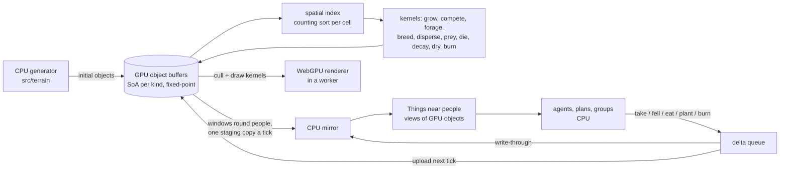

# refactor: GPU-resident per-object world (WebGPU in Bun and the browser)

## Overview

Every living and lying thing on the island becomes an individual object simulated on the GPU: each stem, seedling, log, stick, stone, deer, rabbit, wolf, fox, bird and fish, at the densities measured in the field. Their state lives in GPU buffers, their laws run as WebGPU compute kernels in fixed-point integer arithmetic, and the renderer draws them straight from those buffers. People and their minds stay on the CPU; the objects near them are mirrored back each tick so agents see, take, fell and eat real individuals.

This replaces the population approximations built so far (`src/sim/herds.ts` per-tile densities, `src/sim/fish.ts` stocks, `src/sim/recruits.ts` cohorts) with per-object simulation, as the operator asked, and lands substrate 11's measured densities (real stems, per-piece deadwood) that per-object JavaScript cannot carry.

WebGPU runs headless under Bun through Google's Dawn bindings (`webgpu` npm), inside `bun test`, bit-identical to headless Chrome on the same GPU, and integer kernels were bit-identical across both GPUs of the dev machine and JavaScript. One WGSL codebase serves the play page and the gates.

## Problem Frame

- Substrate 11 found real stem density ~10x and deadwood 1 to 3 orders of magnitude above what the generator lays (docs/research/generator/2026-10-14-flora.md); the operator chose real stems and per-piece deadwood, and GPU use everywhere.
- The generator already lays 3.3 million things (870,000 trees) on seed 1, kept as packed typed arrays (`src/terrain/flora.ts` `Scatter`) and materialized as JavaScript `Thing`s per touched tile (`src/sim/space.ts`). Animals and young plants are densities and cohorts, not individuals; animals are "revealed" out of densities near people.
- The play page runs sim and renderer on the main thread (`demo/styles/play/main.js`); the renderer bakes objects into art chunks on CPU workers (`demo/styles/isopixel/bake.js`, `things.js`); WebGL2 instancing is used once (`gpu.js`, shadow rows). No WebGPU exists.
- `tick(w)` is synchronous everywhere (`src/sim/sim.ts`, `server.ts`, `scripts/run.ts`, `scripts/bench.ts`, `scripts/probes.ts`, `demo/styles/play/sim.js`, several tests); GPU readback is asynchronous.

## Requirements Trace

**World model**
- R1. Every plant stem, seedling, deadwood piece, clast, animal and fish is an individual object at measured density, with its own state (position, size or mass, age, reserves, condition).
- R2. The object an agent sees, takes, fells or eats is the object the GPU simulates and draws: one identity, one state.
- R3. Population behaviour (growth, competition, reproduction, dispersal, foraging, predation, death, decay) emerges from per-object laws; the density and cohort approximations are removed.

**Compute**
- R4. Those laws run as WebGPU compute in fixed-point integer arithmetic, including their transcendental terms, so results are reproducible on any GPU and equal to TypeScript oracles.

**Platform and harness**
- R5. `bun test`, `scripts/probes.ts`, `scripts/evals.ts`, `scripts/run.ts`, `scripts/bench.ts` and `server.ts` run the same kernels headless under Bun and stay reproducible for a seed.
- R6. The play page requires WebGPU (Chrome/Edge 113+, Safari 26); no WebGL2 or CPU fallback is kept.

**Renderer**
- R7. The renderer draws every object from the GPU buffers at interactive frame rates (GPU culling, indirect draws), keeping the isometric pixel-art look and its depth and anchor invariants.

**House rule**
- R8. Every physical constant moved or introduced is cited, [derived], [design] or [gap]; nothing is retuned to pass a check, and the world must still play: scarcity of food and fuel stays meaningful at real densities.

## Scope Boundaries

- People's minds (`src/sim/brain.ts`, `beliefs.ts`, `groups.ts`, planning in `sim.ts`) stay on the CPU.
- The terrain generator (`src/terrain/*`) stays on the CPU; it runs once an island and writes the initial object buffers. Substrate 11's generator laws (climate, rock and erosion, water, ground, niche; docs/research/generator/2026-10-14-*.md) land there independently of this plan.
- No CPU runtime fallback: the TypeScript code that mirrors each kernel exists only as a test oracle (single-step functions in the unit's test file) plus golden checksums for long runs.
- Cross-machine float reproducibility is not needed because gate-relevant arithmetic is integer.

### Deferred to Separate Tasks

- The Bornholm sky (branch `wip/bornholm-sky`): finish on the CPU after Phase A, re-deriving on the game's solar-centred season windows.
- Substrates 6, 7, 8, 9, 12 (walking, work as energy, shelters, hunting and fishing, perception) follow once objects are on the GPU, since they read them.

## Context & Research

### Relevant Code and Patterns

- Systems being replaced: `src/sim/herds.ts` (per-tile `number[]` populations over the 128x128 tile grid, summed-area `box()`, `shared()` predator allocation, `groundFor(w)` static typed arrays), `src/sim/fish.ts` (per-water-tile stocks, animals revealed near people), `src/sim/recruits.ts` (cohorts per stocked tile), `src/sim/plants.ts` and `src/sim/seedling.ts` (growth law and the hourly seedling step), `src/sim/animals.ts` (individual wolves and revealed animals).
- Materialization and identity today: `src/sim/space.ts` (`stock`, `shelve`, `objects`, `around`, `nearestThing`, `lookAround`, `regrow` and its `taken` map), `src/sim/world.ts` (`grown(w, k)`, `HP`, `VERSION`), `src/terrain/flora.ts` (`Scatter`, `FLORA`, `SPECIES`); grid `src/terrain/grid.ts` (N 256, CELL 75 m, TILE_CELLS 2), `TILE_M` 150 m and `TILES` 128 in `flora.ts`.
- Light and canopy: `src/sim/light.ts` (`crownsAt`, `crownRadius`), `src/terrain/growth.ts` (`sieve`/`through`, the two-crown cap), `demo/styles/isopixel/canopy.js` (renderer twin).
- Moisture: `src/sim/wetness.ts` keeps an island reference per thickness (`dead`) and per-Thing paths (`carried`, `laid`); there is no per-cell moisture grid today.
- Renderer: `demo/styles/isopixel/gpu.js`, `live.js`, `bake.js`, `things.js`, `px.js` (`ObjBins` built from `objects().grown`), `demo/styles/isopixel/main.js` (`collectLive`).
- Determinism: `scripts/seeded.ts` (seeded `Math.random`, about 70 call sites), `scripts/bench.ts` checksums, `src/sim/fire.test.ts` seeded replay, `src/sim/world.ts` note that an optimized sort once broke replay; `scripts/evals.ts` sizes jobs by system memory (about 1.25 GB a probe, 2 GB a world).
- Persistence: `server.ts` saves `JSON.stringify(w)` every 50 ticks and reloads it.
- Constraints in `.claude/napkin.md`: never iterate all things on the CPU; frames come from resident chunks; depth `z = 1.5H(u+v) + lev·lp` and anchor invariants.

### Baseline (seed 1, dev machine, current code)

- Smoke run `NOMADS_BRAIN=random scripts/run.ts --ticks 864`: tickMs animals 3.8 to 4.3, ecology 4.4 to 6.9 (machine under load), agents 0.3 to 0.8; deer 1,325, rabbits about 31,800, wolves 14, foxes 168.
- One probe batch (`/tmp`-local batch of seed/two s3) 73 to 140 s depending on load.
- These numbers are re-measured at the start of Phase B on an idle machine and recorded in this plan before any kernel lands.

### External References

- Dawn Node bindings, `webgpu` npm 0.6.2, run under Bun and `bun test` (tested on this Mac): https://github.com/dawn-gpu/node-webgpu
- Bun has no built-in WebGPU (issue 7380): https://github.com/oven-sh/bun/issues/7380
- WGSL float latitude (reassociation, fusion, flush-to-zero) and integer wraparound: https://www.w3.org/TR/WGSL/ sec. 15.7
- Async, whole-buffer readback (gpuweb issue 1972): https://github.com/gpuweb/gpuweb/issues/1972
- Counter-based RNG for reproducible GPU cellular models (Philox): https://arxiv.org/html/1701.03549v2
- Determinism levels in practice: https://developer.nvidia.com/blog/controlling-floating-point-determinism-in-nvidia-cccl
- WebGPU browser support (Chrome 113+, Safari 26; Firefox on Intel Macs pending): https://web.dev/blog/webgpu-supported-major-browsers
- Measured on the dev machine (AMD Radeon Pro 5500M): a 1M-element, 64-step float kernel 1,866 ms in JS against 8 to 12 ms on WebGPU including an 8 MB readback; integer kernels bit-identical across the AMD and Intel GPUs and JS; small readback p50 0.11 to 0.15 ms.

## Key Technical Decisions

- **Per-object state on the GPU, structure of arrays per kind.** Each kind (stems, seedlings, logs, sticks, clasts, low plants, each animal kind, fish) is a set of parallel GPU buffers indexed by object id. Rationale: R1 to R3; the operator wants individuals, not densities.
- **Integer arithmetic end to end in gate kernels.** Gate-relevant state and the arithmetic producing it are fixed-point integers with a documented unit and scale per buffer; exp, log, fractional powers, gamma and lnGamma come from shared fixed-point routines with WGSL and TypeScript twins. No float appears between a buffer read and a buffer write in a gate kernel; float is allowed only in drawing. Rationale: R4; floats differed across GPUs from the 6th digit, integers didn't.
- **Counter-based randomness.** Every draw is a pure hash of (world seed, stream, object id, tick); distributions (uniform, normal, Poisson, exponential, gamma, lognormal, binomial, Weibull quantile) are fixed-point functions of it. CPU-side agent logic keeps the seeded `Math.random`. Rationale: order-free, reproducible, testable against twins.
- **Deterministic allocation.** Births and spawns are counted per parent, turned into indices by an exclusive prefix sum in parent-id order, and written to a free list or the buffer's tail; deaths set a dead flag and free indices are recycled in index order at a fixed point in the tick. Compaction, when needed, is a stable prefix-sum pass. Rationale: same ids every run, no atomic-order dependence.
- **Deterministic contention.** When several objects want one resource (two deer one shoot, two wolves one deer), claims are resolved by a fixed rule (lowest id wins, or a hashed priority) in a two-pass claim/resolve kernel. No float atomics; integer `atomicMin`/`atomicAdd` only where the result is order-free.
- **Spatial index on the GPU.** A counting sort of objects into 75 m cells each tick (stable by id) gives neighbour queries for competition, foraging, predation and crowns. Rationale: per-object laws need neighbours.
- **Identity is the object id.** A `Thing` near people is a view of a GPU object, its id derived from (kind, index, generation) so a recycled index never aliases an old reference. Growth never changes identity. Rationale: R2; resolves the review's identity-triple concerns.
- **Write-through mirror, async tick.** `tick(w)` becomes async: upload the queued deltas, run due kernels, copy the windows around people to a staging ring and await the map at the end of the tick. Deltas an agent queues are applied to the CPU mirror at once (the agent and the next frame see their own felling) and reach GPU state at the next kernel run; everything else in the mirror is at most one tick old. Every caller of `tick` awaits it.
- **Twins as single-step oracles plus golden checksums.** Each kernel has a TypeScript single-step oracle in its test file; long runs are checked against recorded golden checksums. Any rule change lands in the WGSL kernel and its oracle in the same commit: this doubled implementation is the accepted cost of the GPU-first sim.
- **Save and load read back the world.** `server.ts` save reads back every resident buffer once and serializes it with `w` (bumping `VERSION`); load uploads them instead of regenerating. Rationale: GPU state is invisible to `JSON.stringify`.
- **Pin the adapter in headless runs; bound eval concurrency by GPU memory.** Evals and tests choose the adapter explicitly and record it in ledgers; `scripts/evals.ts` limits concurrent children by adapter memory over the measured per-world buffer size as well as by RAM.
- **Generator stays CPU, writes initial buffers.** Rationale: once per island; flood and receiver ordering are sequential.
- **WebGPU required in the browser; the renderer moves to WebGPU inside a worker with OffscreenCanvas.** A `GPUDevice` can't be shared across realms, so the renderer and (later) the sim share one worker. The WebGL2 path is deleted after pixel parity is shown against frames captured before the world changes.

## Open Questions

### Resolved During Planning

- Is Bun the blocker? No: Dawn bindings run under Bun and `bun test`.
- Fallbacks? None (operator).
- GPU sim or CPU fields? GPU, fixed-point, per object (operator); density approximations removed.
- Delta latency? Write-through to the mirror at once; GPU state at the next kernel run.
- Twin scope? Single-step oracles in test files plus golden checksums.

### Deferred to Implementation

- **Fine woody debris per piece exceeds any GPU memory budget at measured volume.** About 12 m³/ha of fine debris is roughly 17,000 one-metre sticks a hectare; over some 11,000 ha of wood that is about 190 million pieces, about 3 GB at 16 bytes each. Logs (coarse debris) at 48 to 154 m³/ha are a few hundred thousand pieces and fit. The operator chose per piece; Unit 9 measures the real buffer size and brings the numbers back for a decision (per piece island-wide, per piece within a radius of people with a pool beyond, or a minimum piece size).
- Seedling counts: recruits produced up to millions of young a season on seed 1; whether every seedling is an object or the smallest age class is held as per-parent counts until it emerges is decided in Unit 8 against the memory budget.
- Exact fixed-point scales per buffer, and table sizes and accuracy for exp/log/pow: set per routine in Unit 2 with error bounds documented.
- Readback window shapes and sizes round people: tuned in Unit 4 against the 0.1 to 3 ms readback latencies measured.
- Linux or GPU-less machines (lavapipe or a fail-fast notice): open; no CI exists today.

## High-Level Technical Design

> *This illustrates the intended approach and is directional guidance for review, not implementation specification. The implementing agent should treat it as context, not code to reproduce.*

Tick shape (async): upload deltas, rebuild the spatial index when due, run the kernels due this tick (hourly moisture, daily plants, per-tick animals as their laws require), copy watched windows to a staging buffer, run the CPU agents against the mirror, await the staging map, merge it into the mirror.

## Implementation Units

### Phase A: GPU foundation

- [ ] **Unit 1: Device layer for Bun and the browser**

**Goal:** One module that yields a `GPUDevice` in Bun (Dawn bindings) and in a browser worker (`navigator.gpu`), loads WGSL, and offers buffer, dispatch and staging-ring helpers.

**Requirements:** R5, R6

**Dependencies:** None

**Files:**
- Create: `src/gpu/device.ts`, `src/gpu/kernel.ts`
- Modify: `package.json` (add `webgpu`), `scripts/demo.ts` (bundle WGSL)
- Test: `src/gpu/device.test.ts`

**Approach:**
- Acquisition is explicit and fails loudly, naming the WebGPU requirement; adapter by env override, default high-performance, name exposed for ledgers.
- Process-lifetime device, released on exit so Bun processes don't hang.

**Test scenarios:**
- Happy path: a doubling kernel over 1M u32 values returns them doubled in `bun test`.
- Happy path: two consecutive staging-ring readbacks return their own submissions' data.
- Error path: an unavailable forced adapter throws an error naming WebGPU; there is no CPU path.
- Integration: a test file using the device exits without hanging the suite.

**Verification:** `bun test` runs a kernel and exits cleanly on the dev machine.

- [ ] **Unit 2: Fixed-point math and randomness**

**Goal:** The integer arithmetic every gate kernel uses, in WGSL with exact TypeScript twins.

**Requirements:** R4

**Dependencies:** Unit 1

**Files:**
- Create: `src/gpu/wgsl/fixed.wgsl`, `src/gpu/wgsl/rand.wgsl`, `src/gpu/fixed.ts`, `src/gpu/rand.ts`
- Test: `src/gpu/fixed.test.ts`, `src/gpu/rand.test.ts`

**Approach:**
- Fixed-point formats with documented ranges; multiply, divide, sqrt, exp, log, fractional pow, gamma and lnGamma by integer tables and polynomial steps, error bounds stated.
- Counter-based generator keyed by (seed, stream, id, tick); uniform, normal, Poisson, exponential, gamma, lognormal, binomial and Weibull-quantile draws in fixed point, matching what `src/sim/recruits.ts`, `herds.ts` and the planned laws draw.

**Test scenarios:**
- Happy path: each routine over a dense grid of inputs gives the TS twin's result bit for bit on the GPU.
- Edge case: each routine at its range limits neither overflows nor loses its stated precision; exp of large negatives underflows to zero exactly.
- Edge case: draws from keys one bit apart are uncorrelated (mean and lag correlation within sampling bounds).
- Integration: the same kernels on the high-performance and low-power adapters give identical output.

**Verification:** Twin equality on both adapters; documented error bounds against float references.

- [ ] **Unit 3: Async tick and harness**

**Goal:** `tick(w)` becomes async and every host awaits it; headless entry points open one device, record the adapter, and size eval concurrency by GPU memory.

**Requirements:** R5

**Dependencies:** Unit 1

**Files:**
- Modify: `src/sim/sim.ts`, `server.ts`, `scripts/run.ts`, `scripts/bench.ts`, `scripts/probes.ts`, `scripts/evals.ts`, `scripts/seeded.ts`, `demo/styles/play/sim.js`, `src/sim/migrate.test.ts`, `src/sim/light.test.ts`, `src/sim/plan.test.ts`, `src/sim/garden.test.ts`, `.claude/napkin.md`

**Approach:**
- Mechanical sync to async conversion first, no behaviour change; then device setup in the entry points; ledgers gain the adapter; `evals.ts` `jobs()` gains a GPU-memory bound.

**Test scenarios:**
- Integration: the full suite and a bench run give the same checksums before and after the async conversion.
- Integration: an eval ledger names the adapter; a full probe-tier run completes with each child holding its own device.

**Verification:** Gates run end to end with a device present and unchanged results.

### Phase B: Objects on the GPU

- [ ] **Unit 4: Object store, spatial index, mirror and persistence**

**Goal:** Per-kind SoA buffers with deterministic allocation, a per-tick spatial index, CPU mirror windows with a write-through delta queue, and save/load.

**Requirements:** R1, R2, R5

**Dependencies:** Phase A

**Files:**
- Create: `src/gpu/store.ts`, `src/gpu/wgsl/alloc.wgsl`, `src/gpu/wgsl/index.wgsl`, `src/gpu/mirror.ts`
- Modify: `src/sim/world.ts` (world owns its store; `VERSION`), `src/sim/sim.ts`, `server.ts`, `scripts/bench.ts` (checksums fold in buffer hashes)
- Test: `src/gpu/store.test.ts`, `src/gpu/mirror.test.ts`

**Approach:**
- Births by per-parent counts and exclusive prefix sums; deaths by flag; free indices recycled in index order; generations on recycled indices.
- Counting sort into cells, stable by id.
- Mirror pages per window; a `stock()` on a cell with no mirror page marks it pending and widens the next window, resolving the next tick rather than returning nothing silently.
- Deltas apply to the mirror at queue time and to GPU buffers at the next upload, in a fixed order.
- Save reads back every buffer once; load uploads.

**Test scenarios:**
- Happy path: 1,000 parents each spawning 0 to 3 children give the same ids and order on every run and adapter.
- Happy path: a delta queued on tick t is visible in the mirror at once and in GPU state after tick t+1's kernels.
- Edge case: a recycled index carries a new generation; a stale reference to the old object resolves to nothing.
- Edge case: two deltas to one object in one tick from different agents apply in a fixed order regardless of arrival.
- Error path: a query outside every window returns pending and is satisfied next tick.
- Integration: a world saved mid-run and reloaded gives identical buffer hashes and identical Things; two bench runs give identical checksums including buffer hashes.

**Verification:** Store round trips under `bun test`; recorded idle-machine baseline tick times are written into this plan.

- [ ] **Unit 5: Things as views of GPU objects**

**Goal:** `space.ts` and its callers read objects from the mirror; the renderer keeps working through a compatibility payload until Phase E.

**Requirements:** R2

**Dependencies:** Unit 4

**Files:**
- Modify: `src/sim/space.ts` (`stock`, `shelve`, `objects`, `around`, `nearestThing`, `lookAround`, `regrow`), `src/sim/world.ts` (`grown`, ids), `src/sim/physics.ts` and `src/sim/sim.ts` (take, fell, pick, eat call sites), `src/sim/ecology.ts`, `src/sim/inspect.ts`, `demo/styles/isopixel/px.js` (`ObjBins`)
- Test: `src/sim/world.test.ts`, `src/sim/space.test.ts` (new)

**Approach:**
- `objects()` keeps emitting a Scatter-shaped payload (tile-ordered arrays plus `gone`) synthesized from the store so the WebGL2 page keeps drawing until Unit 13.
- Taking a piece kills the object; regrowth of sticks, mushrooms and herbs becomes the objects' own processes (litterfall spawns sticks, fruiting spawns mushrooms, green-up spawns herbs) rather than a taken-tick map.

**Test scenarios:**
- Happy path: felling a tree near a person kills that GPU object; it is gone from the mirror, from `around`, and from the compatibility payload.
- Edge case: shelving and restocking a tile gives the same Things with the same ids.
- Integration: the play page still renders flora between Units 5 and 13.

**Verification:** No identity path left that reads `Scatter` indices.

### Phase C: The world as individuals

Each unit lands one kind of object with its laws, a single-step oracle per kernel, golden checksums, a doc note in the relevant research file, and a seed-1 probes and worlds run whose agent outcomes (survival, fuel gathered, food return) are compared against the band recorded at Unit 6. A unit that leaves the world unplayable (food or fuel effectively free or absent) stops the phase for a decision; nothing is retuned to pass.

- [ ] **Unit 6: Flora objects at today's densities (structure only)**

**Goal:** The generator's scatter becomes GPU objects one for one; outcomes unchanged; the playability band is recorded.

**Requirements:** R1, R2

**Dependencies:** Unit 5

**Files:**
- Modify: `src/terrain/flora.ts` (writes initial buffers), `src/sim/world.ts`
- Test: `src/sim/world.test.ts`, `src/gpu/flora.test.ts` (new)

**Test scenarios:**
- Integration: seed-1 counts by kind and species equal today's scatter's.
- Integration: gates unchanged within noise; the band of agent outcomes is recorded.

**Verification:** Same world, new residence.

- [ ] **Unit 7: Stems at measured density with per-stem growth and competition**

**Goal:** Trees and shrubs at measured densities (Reineke for pine and oak, crown packing for ash and aspen, crown widths from Hemery et al., heights by site with a Weibull spread), each stem growing by the calibrated M^3/4 law under its own light, competing with its neighbours, dying, and producing seed.

**Requirements:** R1, R3, R4, R8

**Dependencies:** Unit 6

**Files:**
- Create: `src/gpu/wgsl/stems.wgsl`
- Modify: `src/terrain/flora.ts`, `src/sim/plants.ts`, `src/sim/seedling.ts`, `src/sim/ecology.ts`, `docs/research/plant-constants.md`, `docs/research/rule-audit.md`
- Test: `src/gpu/stems.test.ts`

**Approach:** Stem light from a crown raster built each day on the GPU (Unit 11 shares it); mortality from carbon starvation as in the recruits rule; seed output per stem by species' measured crop.

**Test scenarios:**
- Happy path: a fully covered oak stand at a given top height holds the Reineke count within rounding.
- Happy path: an open-grown stem reaches the calibrated heights at 10 and 30 years within its fixed-point tolerance.
- Edge case: a stem in full shade loses mass and dies by the peak/2 rule; no stem exceeds SDImax crowding.
- Integration: seed-1 island totals (stems by species) match the cited densities; playability band checked.

**Verification:** No remaining `cover × constant` counts for stems.

- [ ] **Unit 8: Seed, seedlings and recruitment per object**

**Goal:** Seed shed by each parent stem disperses by its species' kernel and emerges as seedling objects that grow, are browsed and thinned individually, replacing `src/sim/recruits.ts`.

**Requirements:** R1, R3, R4

**Dependencies:** Units 7, 10 (browsing needs the animals)

**Files:**
- Create: `src/gpu/wgsl/seedlings.wgsl`
- Modify: `src/sim/ecology.ts`; delete `src/sim/recruits.ts` (its logic moves into the oracle in the test)
- Test: `src/gpu/seedlings.test.ts`

**Test scenarios:**
- Happy path: one pine's seed lands with 80% inside one tree height; one ash's at the cited kernel mean.
- Edge case: seed landing on water or under full crowns follows the emergence rules; a parent's death stops its shed.
- Integration: the measured seedling densities (pine under 5,000/ha within 50 m, oak 147 to 287/ha in old fields) are compared and recorded as gaps if they differ.

**Verification:** `recruits.ts` deleted; memory used by seedlings recorded against the budget.

- [ ] **Unit 9: Deadwood and clasts per piece**

**Goal:** Logs and sticks are pieces produced by stem death and litterfall and decaying by their measured rates; boulders, stones and pebbles are pieces from the till power law and Swedish surface counts.

**Requirements:** R1, R3, R8

**Dependencies:** Unit 7

**Files:**
- Create: `src/gpu/wgsl/deadwood.wgsl`
- Modify: `src/terrain/flora.ts`, `src/sim/ecology.ts`, `docs/research/plant-constants.md`
- Test: `src/gpu/deadwood.test.ts`

**Approach:** Measure the real buffer size at unmanaged-reserve volumes first and bring the fine-debris memory decision (see Deferred) back to the operator before landing it.

**Test scenarios:**
- Happy path: a stand at steady state holds the decay-balanced volume V = I/k by piece class.
- Edge case: a picked stick never returns as itself; new sticks come only from litterfall.

**Verification:** Island deadwood volumes recorded against the cited reserve values.

- [ ] **Unit 10: Animals per object**

**Goal:** Deer, rabbits, wolves, foxes and the birds become individuals with energy budgets, movement, foraging on plant objects, breeding, predation and death, replacing `src/sim/herds.ts`; animals near people are mirrored, not revealed.

**Requirements:** R1, R2, R3, R4

**Dependencies:** Unit 7

**Files:**
- Create: `src/gpu/wgsl/animals.wgsl`
- Modify: `src/sim/animals.ts`, `src/sim/ecology.ts`, `docs/research/animal-constants.md`; delete `src/sim/herds.ts` (logic into test oracles)
- Test: `src/sim/herds.test.ts` (rewritten for individuals), `src/gpu/animals.test.ts`

**Approach:** Two-pass claim/resolve for contended forage and prey; energy by the cited FMR and intake laws already in `animal-constants.md`.

**Test scenarios:**
- Happy path: a lone deer's energy budget over a day equals the oracle's.
- Edge case: two predators claiming one prey resolve the same way every run.
- Integration: seed-1 densities over a few years compared against the documented densities table; differences recorded as model gaps.

**Verification:** `herds.ts` deleted; animal counts and tick time recorded.

- [ ] **Unit 11: Fish per object**

**Goal:** Fish as individuals in each connected body of water, replacing `src/sim/fish.ts` stocks.

**Requirements:** R1, R3, R4

**Dependencies:** Unit 10

**Files:**
- Modify: `src/sim/fish.ts` (deleted; logic into oracles), `src/sim/physics.ts` (fishing takes an individual)
- Test: `src/sim/materials.test.ts` (fishing), `src/gpu/fish.test.ts`

**Test scenarios:**
- Happy path: a fishing try near shore can only catch fish present in that water.
- Integration: biomass per hectare over a year compared against the recorded 46 to 51 kg/ha.

**Verification:** `fish.ts` deleted.

- [ ] **Unit 12: Light, canopy, moisture and fire from objects**

**Goal:** A daily crown raster from stem objects feeds light, interception and the renderer's canopy; dead-fuel moisture becomes a per-object property for everything lying out (sticks, logs, litter) updated hourly; fire spreads across objects.

**Requirements:** R3, R4, R7

**Dependencies:** Units 7, 9; Unit 13 for the canopy texture hand-off

**Files:**
- Create: `src/gpu/wgsl/crowns.wgsl`, `src/gpu/wgsl/moisture.wgsl`, `src/gpu/wgsl/fire.wgsl`
- Modify: `src/sim/light.ts`, `src/sim/rain.ts`, `src/terrain/growth.ts` (`sieve`/`through`, removing the two-crown cap), `src/sim/wetness.ts`, `src/sim/spread.ts`, `src/sim/fuel.ts`; delete `demo/styles/isopixel/canopy.js` once Unit 13 consumes the raster
- Test: `src/sim/light.test.ts`, `src/sim/rain.test.ts`, `src/sim/fire.test.ts`, `src/sim/fuel.test.ts`, `src/sim/wetness.test.ts`, `src/sim/herds.test.ts`

**Test scenarios:**
- Happy path: felling a stem changes light at its foot after the next crown pass in sim and renderer.
- Happy path: a lying stick's moisture equals the island reference for its thickness under uniform weather.
- Edge case: overlapping crowns add optical depth without a cap.
- Integration: the seeded fire replay test passes on the GPU path.

**Verification:** One crown source of truth; per-object moisture replaces the per-Thing paths.

### Phase D: Renderer on WebGPU

- [ ] **Unit 13: WebGPU renderer in a worker, pixel parity**

**Goal:** Reproduce the isopixel pipeline (point-splat MRT, fill, combine, composite, sun map, terrain AO) on WebGPU inside a worker with OffscreenCanvas, then delete the WebGL2 path.

**Requirements:** R6, R7

**Dependencies:** Unit 1. Reference frames are captured from the WebGL2 pipeline on a build before Unit 5 and committed; deletion is gated on matching them.

**Files:**
- Create: `demo/styles/isopixel/webgpu.js`, `demo/styles/isopixel/worker.js`
- Modify: `demo/styles/isopixel/live.js`, `demo/styles/play/main.js` (WebGPU-required notice), `demo/styles/isopixel/gpu.js` (deleted after parity)
- Test: reference frames under `demo/styles/isopixel/reference/` compared on a real GPU (not SwiftShader, per napkin)

**Test scenarios:**
- Integration: fixed cameras and seed render palette-index identical (or within a recorded tolerance) to the committed reference frames.

**Verification:** The page runs on WebGPU only; frame cost recorded with `?bench=`.

- [ ] **Unit 14: Draw every object from the buffers**

**Goal:** Cull-and-draw kernels read the object buffers and emit indirect draws of sprite splats; bake workers stop rasterizing objects.

**Requirements:** R2, R7

**Dependencies:** Units 5, 6, 13; lands with or after Unit 7 so real densities are drawn

**Files:**
- Create: `demo/styles/isopixel/wgsl/objects.wgsl`
- Modify: `demo/styles/isopixel/bake.js` (terrain only), `live.js`, `things.js` (sprite atlases), `px.js` and `demo/styles/isopixel/main.js` (`collectLive`, compatibility payload removed)

**Test scenarios:**
- Integration: an object killed in the sim disappears from the next frame.
- Integration: drawn positions of a sample of objects equal their buffer positions.

**Verification:** Seed-1 view at real densities holds the frame budget at default zoom.

- [ ] **Unit 15 (optional): Sim tick in the render worker**

**Goal:** Move the sim tick into the render worker so sim and renderer share one device; the page thread keeps UI only.

**Requirements:** R7

**Dependencies:** Units 4, 13; gated on a measured main-thread long-task figure after Unit 14

**Files:**
- Modify: `demo/styles/play/main.js`, `demo/styles/play/sim.js`, `demo/styles/isopixel/worker.js`

**Test scenarios:**
- Integration: UI panels keep updating from posted snapshots while the worker ticks and draws.

**Verification:** No main-thread long tasks during play.

## System-Wide Impact

- **Interaction graph:** every reader of things via `space.ts`; `light.ts`, `rain.ts`, `wetness.ts`, `spread.ts`, `fuel.ts`, `plants.ts`, `seedling.ts`, `ecology.ts`, `animals.ts`, `physics.ts`, `inspect.ts`; the renderer's `ObjBins`, `bake.js`, `canopy.js`; `server.ts` persistence.
- **State lifecycle risks:** deltas apply exactly once; recycled indices never alias stale references; saves capture GPU state; the mirror is never older than the previous tick's readback.
- **Determinism:** integer arithmetic and counter hashes everywhere a gate reads; any float there is a defect; adapter recorded in ledgers.
- **Unchanged invariants:** people's minds and the learning probes' logic; the renderer's depth and anchor invariants; the house citation rule.
- **Gates:** Phase A changes no outcomes; every Phase C unit re-baselines with a doc note and a playability judgement, never a retune.

## Risks & Dependencies

| Risk | Mitigation |
|------|------------|
| Fixed-point transcendentals are slow or imprecise | Tables plus polynomial steps with stated error bounds; measured in Unit 2 before any law ports |
| Memory at real densities (stems 5 to 8 million, seedlings, deadwood pieces) | Per-kind budgets measured at each unit; fine-debris decision brought back with numbers (Deferred) |
| Real densities make food or fuel free or absent | Playability band from Unit 6 checked at every Phase C unit; stop and decide, never retune |
| Dawn bindings regress under a Bun upgrade | Pin `webgpu`; the device test catches it first |
| Readback latency stalls ticks in the browser | Staging ring; write-through mirror for own deltas |
| WebGPU port loses the look | Reference frames committed before Unit 5; deletion gated on parity |
| GPU-less machines can't run tests | Accepted (operator); lavapipe vs fail-fast still open |

## Success Metrics

- Seed 1 holds measured densities as individuals: stems, seedlings, logs and clasts at the cited values, sticks per the decision in Unit 9, animals and fish as individuals.
- Resident GPU memory for seed 1 at or under 1.5 GB [design] on the dev GPU, recorded per kind.
- A whole-island daily step (plants, seedlings, deadwood) at or under 50 ms and a per-tick animal step at or under 5 ms on the dev GPU [design]; compared against the idle baseline recorded at Unit 4.
- Default-zoom play at or under 16.7 ms a frame drawing every object in view [design].
- Gates run headless on the GPU, ledgers naming the adapter, reproducible run to run and across both adapters of the dev machine.
- Agent outcomes at real densities stay within the playability band recorded at Unit 6, or the difference is judged and documented.

## Phased Delivery

- **Phase A** (Units 1 to 3) lands alone and changes no outcomes.
- **Phase B** (Units 4, 5) moves residence and identity; outcomes unchanged.
- **Phase C** (Units 6 to 12) lands one kind at a time; Unit 6 records the playability band; each later unit re-baselines.
- **Phase D** (Units 13 to 15) starts after Phase A (reference frames captured before Unit 5), runs alongside B and C, and meets them at Unit 14; Unit 15 is optional.

## Documentation Plan

- `DESIGN.md`: everything is an individual on the GPU; WebGPU required; how people see and act on GPU objects.
- `.claude/napkin.md`: async tick, device lifetime in Bun, adapter pinning, integer-only gate arithmetic.
- Research docs: fixed-point scales and error bounds where constants move; the deleted approximations' replacement laws in `animal-constants.md` and `plant-constants.md`.

## Sources & References

- Generator research: `docs/research/generator/2026-10-14-flora.md` (densities, crowns, deadwood, clasts) and its siblings.
- Rule audit: `docs/research/rule-audit.md` secs. 10, 11.
- Systems replaced: `src/sim/herds.ts`, `src/sim/fish.ts`, `src/sim/recruits.ts`.
- External: links under Context & Research.
