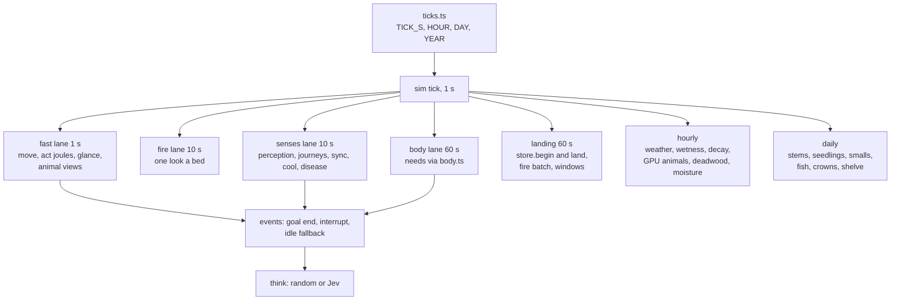

# refactor: a one-second tick, with every other process on its own clock

## Overview

The sim steps in ticks of 300 s (`src/sim/sky.ts` `DAY = 288`, `TICK_S = 86400 / DAY`). The operator chose to shorten the tick toward seconds so that people and the animals near them move and act at real speed with a fine step. This plan moves the world to a 1 s tick for the fast processes people meet (walking, running, chases, blows, throws, fire near them), keeps every hourly and daily law on its own clock (weather, wetness, decay, the GPU's stems, deadwood, moisture, animals, fish, seedlings, smalls and crowns), and makes brains decide on events rather than on ticks.

A 1 s tick cannot simply replace a 300 s one: everything that runs once a tick today would run 300 times as often, and today's tick costs more than a second under load. So the plan has three phases:

- **Phase A, one clock.** Every tick count, per-tick chance and per-tick increment in the code is written in seconds through one leaf module, with `TICK_S` still 300. Result-identical: bench checksums and gate ledgers do not move.
- **Phase B, many rates.** Each process gets its own period (1 s, 10 s, 60 s, an hour, a day) and is handed the seconds since it last ran; the GPU's begin and landing get their own cadence instead of one a tick; brains decide on events. At `TICK_S = 300` every sub-tick period runs each tick with 300 s, so this is result-identical too.
- **Phase C, real time.** `TICK_S` becomes 1, the save `VERSION` is bumped, acts become energy over power (substrate 7), animals near people move at real speed, and the gates are re-baselined once per unit, never retuned.

## Problem Frame

- People walk 2 m a tick (`src/sim/sim.ts` `WALK = 2, RUN = 6`, "meters a tick"), 0.0067 m/s; animals the same way (`src/sim/fauna.ts`, "meters a tick of five minutes"). Substrate 6 (in the working tree: `src/sim/gait.ts`, "Speeds are m/s and costs W; ticks come in only through sky.ts TICK_S") makes walking real in sim time, which at 300 s ticks puts a walker 390 m on per tick and a runner past the whole 800 m `SEARCH` in two ticks. Chases, throws (`src/sim/hunt.ts` `throwsInTick`) and fights need a step a fleeing deer crosses in metres, not hundreds of metres.
- Act durations are tick counts (`src/sim/physics.ts` `DURATION`: join 8, heat 8, wet 10, shape 6, place 3, plant 3, pour 2, wear 2), compared against a progress of one a tick (`sim.ts` doAct). The rule audit's substrate 7 (`docs/research/rule-audit.md` sec. 7) asks for work as energy over a person's sustainable power instead.
- The hour is written as the literal 12 in about twenty places on the CPU and as three independent constants on the GPU (`src/gpu/tiers/drivers.ts` `HOUR = 12`, `src/gpu/animals.ts` `STEP_TICKS = 12`, `src/gpu/fish.ts` `DAY_TICKS = 288`), and the renderer keeps its own `DAY = 288` (`demo/styles/isopixel/live.js`, `demo/styles/play/main.js`, `public/*.js`). Change `DAY` alone and the clocks part company silently.
- Per-tick costs scale with ticks a real second. Today's tick is dominated by the GPU's upload and landing (Baseline), and the CPU's per-tick work walks every live thing several times (`ecology.ts` builds `liveThings` six times a tick). Today's shape at a 1 s tick would cost about 300 times as much per sim day.
- The page runs the sim in the render worker (`demo/styles/play/sim.js`, `demo/styles/isopixel/worker.js`) and must hold 16.7 ms frames; it paces one tick per 500 ms at speed 1 (`demo/styles/play/remote.js` `BASE_MS`, also `server.ts`), so the world runs at 600 sim seconds a wall second, and warms for 2016 ticks (7 sim days). Probes and worlds evals run days of sim (`scripts/evals.ts`: probes 5 days on 10 seeds, worlds 60 days on 6, planting probes two springs of 56 days).

## Requirements Trace

**Time**
- R1. One definition of time: `TICK_S` and every derived count (`HOUR`, `DAY`, `YEAR`) come from one leaf module that the CPU sim, the GPU laws, the harness and the page all read; no literal 12, 288 or 2016 that means time remains.
- R2. Every duration, cooldown, give-up, speed, chance and rate in the code is stated per second (or per its own period) and spent through `TICK_S` or the elapsed seconds of its lane; nothing depends on how long a tick is except resolution.
- R3. The tick is 1 s for people, the animals they can see, and their acts; fire beds step by their own 10 s look; hourly and daily laws keep their hours and days.

**Behaviour**
- R4. People and the animals near them move at real speed: speeds in m/s from gait and animal physics, a step of at most a few metres for anything people chase or flee.
- R5. Acts with durations are processes of energy delivered at a power (substrate 7); the planner, the answer key, beliefs and the look-ahead read their expected time as energy over power.
- R6. Brains decide when something happens (a goal ends or fails, a need crosses a cut, a threat or a person appears, someone addresses them) and at an idle fallback in sim seconds, never once a tick; Jev calls a sim day stay at today's level.

**Cost**
- R7. The page holds 16.7 ms frames at its default speed with the sim's share of a frame within its budget and no single sim stall past it.
- R8. A probes gate and a worlds eval take no more than 1.5 times today's wall time on the operator's Mac at the same sim days, or the operator decides otherwise.

**Platform**
- R9. Phases A and B change no outcome: bench checksums and gate ledgers are identical before and after each unit. Phase C units each re-baseline with a doc note and a playability judgement; nothing is retuned to pass.

## Scope Boundaries

- The GPU laws' own steps stay as they are: animals hourly, deadwood and moisture hourly, stems, seedlings, smalls, fish and crowns daily (docs/plans/2026-10-14-001-refactor-gpu-object-world-plan.md). Only the tick count that names an hour or a day changes.
- Substrates 6 (walking and carrying), 9 (throwing, hunting, fishing) and 12 (perception) are landing separately in the working tree (`src/sim/gait.ts`, `src/sim/hunt.ts`, `src/sim/senses.ts`); this plan reads them and does not redo them.
- `YEAR_DAYS = 40` and the year's pace (`YEARS_PACE = 365.25 / YEAR_DAYS`) stay; the calendar is not compressed further or uncompressed.
- The renderer's look and its depth and anchor invariants are untouched; only its time twins and pacing change.

### Deferred to Separate Tasks

- Shelters as thermal resistance (substrate 8) and the body's remaining bars: no tick dependence beyond what Unit 3 converts.
- Sub-second physics (a blow's impact, an arrow's flight) stays inside each act's own physics (`hunt.ts` flight with drag, `mechanics.ts` blows); no tick finer than 1 s is planned.

## Context & Research

### Relevant Code and Patterns

- The one correct seam today: `src/sim/sky.ts` `TICK_S`, already used by `src/sim/body.ts` (`warm`, `feed`, `pressure` take seconds), `src/sim/mechanics.ts` (`BLOWS = CADENCE * TICK_S`, the shape every per-tick quantity should take), `src/sim/combustion.ts` (all seconds, `STEP = 10`), `src/sim/spoil.ts` (per hour), `src/sim/gait.ts` and `src/sim/hunt.ts` (m/s, seconds).
- Duplicated `TICK_S`: `ecology.ts`, `physics.ts`, `sim.ts` (conditionsNow), `migrate.ts` (must keep the old 300 s to read old saves), `scripts/probes.ts`, `src/sim/combustion.test.ts`.
- The GPU tick loop: `src/gpu/store.ts` `Law = { due: (t) => boolean }`, `begin(t)` runs due laws and re-indexes touched kinds every tick, `land()` reads back windows and riders every tick; `src/gpu/mirror.ts` promises a pending lookup "the next tick".
- Saves: `server.ts` writes `world.json` every 50 ticks and the GPU dump (`store.dump`) beside it; `load()` keeps a save only at the current `VERSION` (29, `src/sim/world.ts`) and otherwise sets it aside and makes a new world; `src/sim/migrate.ts` rewrites old shapes inside one `VERSION`.
- Page pacing: `remote.js` `update()` asks for at most one tick per call, `iv = BASE_MS / speed`, interpolates by `alpha`; the warm asks one tick a frame (`iv = 0`); `worker.js` posts state after every tick.
- Brain: `src/sim/brain.ts` `ask()` is the only Jev call site, with no rate limit; `sim.ts` agentTick calls `think()` when `w.t >= a.nextDecide`, which is set to `w.t + 1`, `+ 2`, `+ 10` ticks (`life.ts` `+ 5`); headless runners wait on `asking()` each tick.

### Tick Dependence Inventory

Classes: (a) already seconds through `TICK_S`, scales by itself; (b) a tick count that must become seconds; (c) a per-tick chance or increment that must become a rate over time; (d) a cadence that keeps its own hour or day clock; (e) a cost that scales with ticks a real second. Line numbers are as of 933424f plus the working tree on 2026-10-16 and move; function names are the anchor.

**Clock anchors and twins (b)**
- `src/sim/sky.ts` `DAY = 288`, `TICK_S`, `YEAR_DAYS`; `src/sim/world.ts` re-exports, `YEAR = DAY * YEAR_DAYS`, start at `round(DAY * 0.3)`, `VERSION = 29`.
- GPU: `src/gpu/tiers/drivers.ts` `HOUR = 12` (not imported from the sim, to keep kernels free of it), `src/gpu/animals.ts` `STEP_TICKS = 12` and a local `DAY`, `src/gpu/fish.ts` `DAY_TICKS = 288`, `src/gpu/deadwood.ts` `DAY_TICKS = 24 * HOUR`, `src/gpu/moisture.ts` `HOUR_TICKS = 12`, `KEEP_TICKS = 288`. `src/gpu/tiers/dormant.test.ts` asserts `HOUR * 24 === DAY`.
- Renderer and page: `demo/styles/isopixel/live.js` `DAY = 288, YEAR = DAY * 40` (ages people at `(t - born) / YEAR`), `demo/styles/play/main.js` three literal 288s (graph span, tooltip clock), `public/app.js`, `public/debug.js`, `public/history.js`. `demo/sim.ts` already exports the sim's `DAY`, which `play/sim.js` posts to the page.

**The hour as 12 (d, written as b)**
- `ecology.ts`: the sky's turn, ice (`day = 1/24` per call), the day's rain tally, saplings, decay, the 20-year sky spin-up (`t = h * 12`), `forecast()` hour steps.
- `wetness.ts` `if (w.t % 12) return` and the GPU hour word `Math.floor(t / 12)`; `groups.ts` `closeWatches`/`speak` and `floor(w.t / 12)`; `animals.ts` butterflies, `reveal`, `showFish`; `scripts/probes.ts` `6 * 12`; `play/sim.js` census `SAMPLE = 12`; `bench.ts` "an hour" of 12 ticks; tests in `materials`, `wetness`, `plan` ("the sky only turns on the twelfth tick").

**Durations, cooldowns and give-ups in ticks (b)**
- `physics.ts` `DURATION`; `sim.ts` doAct progress `+= 1 + skill`; `formulas.ts` reads `DURATION[f.verb] ?? 4` for the answer key; `plan.ts` `PICK = 2.5` ticks; `physics.ts` rubbing `r.ticks`, digging done at 12 units, throw every third tick (`++st.progress % 3`), strike damage every fifth.
- `sim.ts`: `cooldowns[type] = w.t + 60` (failed plan), `nextDecide = w.t + 2`, `+ 30` give-up, `+ 1` after a goal ends, feasibility cache 40, brain error `+ 10`, social 40, huddle 30, collapse `down = w.t + 2`, interrupt 40, stranger re-notice 150, goal younger than 5, tend gives up at 60, assist `+ 1`, approach 40 tries, chase 60, stalk 80; `life.ts` newborn `nextDecide + 5`.
- Persisted ticks: `Belief.ticks`, `Belief.later` (`beliefs.ts`, written by `sim.ts` record), `Kind.fuel` legacy tick counts (`materials.ts`, read by `physics.ts` forge detection), `Agent.near` ("ticks spent close"), every instant (`down`, `nextDecide`, `born`, `sickness.until`, `pregnant.due`, `cooldowns`, `seen`, Camp, Precedent, Custom, Event, Journey, `Thing.until/born/died/gleaned.t`). Player-visible text: `beliefs.ts` sentence (`ticks * 5 / 60` hours), `inspect.ts` "burns N ticks", "out cold for N ticks".
- Speeds: `sim.ts` `WALK`, `RUN` (substrate 6 replaces), `fauna.ts` `FAUNA` walk, run, fly, carried into `walk.ts` `walk`/`steer` as metres a tick.

**Per-tick chances and increments (c)**
- `ecology.ts`: lightning `poisson(stormFlashes / 12)` every tick, resin `1 - exp(-1 / (RESIN_DAYS * DAY))`, berry crop `/ (YEAR / 2)`, bush hp `+ 0.02`, ash `rainAt * 24 / DAY`, sickness `health -= 0.06 * severity` and `sleep += 0.0005 * severity`, contagion `0.003 * severity` within 10 m (also O(people squared)).
- `sim.ts` needs: social `- 0.05`, health `+ 0.1` a tick; `near[b] += 1`; `physics.ts` bare-hand digging `health -= 0.05`.
- `animals.ts` CPU views: re-aim 0.02, roam odds 0.3, 0.9, 1, move pasture 0.05, approach mate 0.3, roam 0.15, join pack 0.3, heron feed 0.02 and step 0.2, gull wake 0.002, land 0.003, feed 0.01, crow leave 0.005, perch 0.004, butterfly flower 0.03; `lift()` rates 4/3, 4, 2, 15, 3, 0.5, 0.6; wolf bite 6 hp a tick; crow eats one meat a tick; starving hp `- 0.05`; state timers `inState > 4`, `< 6`, `> 40`, `> 5`, `> 30 + quirk`, `> 20`, `> 12`, `> 5 + quirk`.
- Already per day behind a daily gate, safe while the gate stays (d): `life.ts` old-age hazard, `ecology.ts` crowding 0.12, path decay 0.3, regrowth hazards.

**A fire bug at short ticks (a, broken)**
- `ecology.ts` fire: `for (let s = 0; s < TICK_S; s += LOOK_S)` with `LOOK_S = 10` runs once when `TICK_S` is under 10 and still advances each bed by 10 s, so beds would burn ten times too fast at 1 s, and `src/gpu/fire.ts` would receive one look a batch instead of thirty.

**GPU cadences (d), with their per-step constants**
- Hourly: animals (`due: t % STEP_TICKS === 0`, `per = 24`, `tps`; per-step chase `K.chase`, warren move `K.move` within 50 m, dispersal `K.disp`, FMR and intake by the day's share), deadwood (rates per hour through the driver ring, `born` in hours), moisture (queued by `wetness.ts` each hour), drivers ring (`advance()` an hour, own counter), seedlings ahead (`t % (dayTicks / 24)`).
- Daily: stems (`plants.ts` `due: t % DAY === 0`) with "stems ahead" on every other tick, seedlings (shed over the day's first 32 ticks), smalls (midnight), fish (`DAY_TICKS`, `G.year` in ticks), crowns (a 4.25 MB pass landed a slice a tick over 32 ticks).
- Ticks stored on the GPU: `born` a full u32 tick in animals and fish (ages guarded at 2^31, 68 years at 1 s), event-tier waits in 31 bits (`wgsl/events.ts` `NEVER = 0x7fffffff`, 68 years at 1 s), `K.mature = grown * YEAR` in ticks; dormant and deadwood `born` in hours and seedling bins in days (unaffected). Every Philox draw keys on the tick (`wgsl/rand.ts`), so a new tick length re-rolls every stream.

**Per-tick costs (e)**
- `sim.ts` tick: `gpu.begin`, `ecology` (fire, plants, holes, animals, cool, decay, disease, paths, overgrow, settle), `life`, `groups`, every `agentTick` (needs through the body model, perception, interrupts, plan steps), `travel` (journeys sample every person), `flora.watch`, `smallsOf(w).watch`, `gpu.land()`.
- `store.ts` per tick: delta upload, law dispatch, reclaim and re-index of touched kinds (about 65 ms per 10^7 objects), one readback with windows, PEEKs and every rider (animal census over 2^17 slots, crowns slice, fire batch, lumped fates); `animals.ts` `sync()` sweeps cells round every awake person; `light.ts`, `air.ts`, `rain.ts` memos key on `w.t`.

**Harness, server and page (b, e)**
- `scripts/run.ts` `--ticks` (default 5000) and a 20 ms sleep a tick with Jev; `scripts/bench.ts` `--days 20`, a microtask yield every 4 ticks, checksums hash `w.t`; `scripts/probes.ts` cadences `DAY / 6` and `DAY`, `START = 12 * DAY + 6 * 12`, beliefs with `ticks` and `later: 3 * DAY`; `scripts/evals.ts` `VERSION = { probes: 7, worlds: 6, live: 6 }`, trace buckets by `DAY`; `scripts/answer-key.ts` and `scripts/theory-report.ts` score in ticks (`expectedTicks`, regret capped at `DAY`); `scripts/theories.ts`, `tech.ts`, `truth.ts` loop `days * DAY`.
- `server.ts` `BASE_MS = 500`, speeds 1 to 16, save every 50 ticks, `costPerDay` by `w.t / DAY`, events capped at 50,000; `play/sim.js` trims events every 50 ticks, warm counted in ticks with progress every 50; `main.js` `?warm=2016` (clamp 40,000), `?speed` 0.25 to 32 ("32 runs a day in about five seconds"), follow interval `500 / speed`; `src/sim/trace.ts` `tickMs` is an EMA over about 20 ticks.

### Baseline (seed 1, dev machine)

- Smoke run `NOMADS_BRAIN=random bun scripts/run.ts --ticks 864 --seed 1 --minutes 25` on a clean worktree of 933424f (the working tree did not compile mid-edit by other agents), at load average 34 with six probe processes and a herds test sharing the GPU: 435 ticks in 1,502 s, the first 202 (waking, the GPU's spin-up) taking 1,008 s and the next 233 about 2.1 s each. `tickMs` EMA at the end: land 901, upload 559, ecology 479 (of it animals 433, weather 36, cool 3.0, plants 1.6, fire 1.5, disease 0.9, decay 0.9, holes 0.5), agents 130, shelve 74, journeys 4.3, life 0.6, groups 0.4. The GPU's upload and landing are about 70% of a tick. 5 people, deer 994, rabbits 48,169, wolves 14, foxes 148, fish 2,675,717; 13 decisions.
- Recorded at lower load (`demo/styles/isopixel/reference/bench-r9b.json`, same command): upload 48.4, animals 2.7, ecology 3.1, agents 3.6, land 216.9, shelve 4.0; a warm tick in the page about 0.2 s, holding the worker's frames to about 20 a second. The GPU plan's Unit 4 baseline: animals 3.8 to 4.3, ecology 4.4 to 6.9, agents 0.3 to 0.8. Units 5 and 6: the page ticked in about 9 ms. The stems' daily step: about 38 ms of kernels, 19 ms of CPU and 84 to 88 ms landing 20 MB.
- Gates (`.claude/napkin.md`, before the GPU world): probes 19 min on 10 seeds six at a time, worlds about 7 min for six islands; a planting probe of 56 days about 3 min. Page load with the default warm 60 to 200 s.
- What a 1 s tick of today's shape would cost: the CPU's per-tick work alone (agents plus ecology, 6.7 ms in bench-r9b) is 1.9 s a sim day at 288 ticks and 579 s at 86,400; the per-tick landing at even 2 ms would add 173 s a sim day.
- These are re-measured on an idle machine at the start of Phase B and written here before Unit 5 lands.

### External References

- None beyond the repo's research documents: walking speeds and costs are substrate 6's (docs/research/people-constants.md sec. 6), throws and flight substrate 9's (sec. 9), fire's look `LOOK_S` and combustion's step fire-constants', blows matter-constants'. The sustainable power for substrate 7 (75 to 100 W, rule-audit sec. 7) is uncited and is researched in Unit 9.

## Key Technical Decisions

- **The tick is 1 s.** The fastest processes people meet: a walk at about 1.3 m/s and a run at 3 to 6 m/s (substrate 6), a fleeing deer or wolf at the 8 m/s `FAUNA` lists [gap: uncited], a blow every 1.7 s (`CADENCE = 35 / 60`), a hand throw reaching 20 m and a bow 40 m (`physics.ts` `throwReach`). At 1 s a fleeing deer moves 8 m a tick, under half a throw's reach, and a runner closes 6 m; at 5 s the deer moves 40 m, twice a hand throw's reach, so a throw's window opens and closes inside one tick and a chase is decided in two or three steps. `TICK_S` must divide 10 (fire's look), 60 and 3600; 1 s does. What is faster than a second (a blow's impact, a projectile's flight) is solved inside the act (`hunt.ts`, `mechanics.ts`), not by a finer tick.
- **One leaf clock module.** `src/sim/ticks.ts` holds `TICK_S`, `HOUR = 3600 / TICK_S`, `DAY = 86400 / TICK_S`, `YEAR_DAYS`, `YEAR`, and the helpers (`every`, `chance`, `rate`, `ticksOf`), with no imports, so `src/gpu/*` can import it without pulling in the sim (the reason `drivers.ts` keeps its own `HOUR` today). `sky.ts` and `world.ts` re-export it; `demo/sim.ts` already carries `DAY` to the page, and the renderer reads the posted value.
- **Exact identity at 300 s.** `chance(p, over)` turns a chance per `over` seconds into a chance per tick, `1 - (1 - p) ** (TICK_S / over)`, and returns `p` itself when `TICK_S === over`; `rate(x, over)` does `x * TICK_S / over`, returning `x` when equal. Today's per-tick values enter with `over = 300` and are marked [design: today's per-tick value] until a substrate cites them. This keeps Phases A and B bit-identical, checked by bench checksums.
- **Lanes, not one loop.** Each process declares a period and gets the seconds since it last ran: fast (1 s): people's movement, act progress, threat glance, the CPU views of animals people can see; fire (10 s): every bed advances one look; body (60 s): needs through `body.ts`; senses and bookkeeping (10 s): full perception, `journeys.travel`, `animals.sync`, `cool`, disease and contagion; hourly and daily as today. A lane whose period is shorter than `TICK_S` runs every tick with `dt = TICK_S`, which is today's behaviour exactly.
- **The GPU lands on its own cadence.** `store.begin` and `store.land` run every `LAND_S` sim seconds (60 s proposed, a divisor of 3600, so hourly and daily `due` predicates still fall on begins), not every tick; deltas write through to the mirror at once as now; windows widen by the fastest person's run over `LAND_S` (360 m at 6 m/s) beyond `SEARCH`; work sliced "a slice a tick" (crowns, seedlings' shed, stems ahead) becomes a slice a landing; fire receivers' batch carries the looks gathered since the last landing (six at 60 s), so the GPU's work per sim hour is today's.
- **Hourly and daily laws are unchanged on their own clocks.** Their periods are hours and days; only the tick count naming them changes. The animals' WGSL keeps a step of an hour (`STEP_TICKS = HOUR`, `per = 24`), so `K.chase`, `K.move`, `K.disp` and the per-step energy stay per hour.
- **Animals near people are CPU views at 1 s; the GPU keeps its hourly law.** `animals.sync` (10 s lane) makes views of the objects within `SEEN` of awake people and holds them on the GPU as today; the fast lane moves views at their real speeds with per-second hazards; their positions write back at each landing; an animal leaving `SEEN` is released at its CPU position to the hourly law. Stepping near-people animals on the GPU each second was rejected: a dispatch and a readback (0.11 to 0.15 ms p50) every second for tens of animals costs more than the CPU and puts a GPU round trip in the 1 s lane. Fish stay hourly views (`showFish`): people meet them by encounter rate (`hunt.ts`), not by chase.
- **Fire beds burn on a 10 s lane.** Each run advances every live bed by exactly `LOOK_S` per look owed, which also fixes the sub-10 s bug; people's warmth and burns read bed output in the fast lane.
- **Brains decide on events.** `think()` runs when a goal ends or fails, an interrupt fires (critical need, dark, threat, someone addressing them, already `plan.interrupt`), or an idle fallback in sim seconds passes. Each `nextDecide` is classified in Unit 2: "the next tick" stays one tick; backoffs become seconds with today's values. A meter counts Jev calls per sim hour and per wall minute against the relay's 300 a minute and 16 at once.
- **Acts are energy over power.** An act carries the work it needs (J) and the doer delivers a power (W) times their efficiency (skill), less in poor light; helpers add their power; progress is joules, done when they reach the work. The expected time (work over power) feeds the planner (`plan.ts` costs in seconds), the look-ahead (`conditionsNow`), the answer key (`formulas.ts`) and beliefs (`Belief.ticks` becomes seconds). Until substrate 7's research cites each act's work, an act's work is today's duration in seconds times the reference power [derived; gap].
- **Saves: a new `VERSION` starts a new world.** At Unit 8 `VERSION` becomes 30; `server.ts` sets old saves aside and makes a new world, as every GPU unit has. A time-rescaling migration would have to rewrite about 30 persisted tick fields and the GPU dump's tick words per kind (animal and fish `born`, event-tier waits) for a world whose learned durations no longer apply. `migrate.ts`'s passes rewrite shapes no `VERSION` 30 save can hold, so they and `migrate.test.ts` go with the bump.
- **Harness and page speak sim seconds and days.** Runs take `--days` or `--hours` (`--ticks` stays for tests); the page and server pace by a speed in sim seconds a wall second (default 600, today's pace), run as many ticks as are due each frame within the sim's frame budget, let the sim clock slip rather than drop frames when behind, interpolate within the last tick, and post state once a frame. The warm is counted in sim days (7, today's 2016 ticks; one since Unit 11's outcome, where a week of 1 s ticks took about 9 minutes).

## Cost Model

Per sim second, with $F$ the fast lane's cost a tick and $c_k$ the cost of lane $k$ with period $T_k$:

$$C = F + \sum_k \frac{c_k}{T_k} + \frac{L}{T_L} + \frac{H}{3600} + \frac{D}{86400}$$

where $L$ is a landing every $T_L$ = `LAND_S`, $H$ the hour's work (weather, wetness, decay, saplings, the GPU's hourly laws) and $D$ the day's (stems, seedlings, smalls, fish, crowns, shelve). $H$ and $D$ are the same per sim day at any tick; they move from per-tick to sliced work only where they were sliced by ticks.

**The page.** At speed $S$ sim seconds a wall second and 60 frames a second, the sim's share of a frame is $S \cdot C / 60$. With the renderer leaving about 8 ms of the worker's 16.7 ms frame [design; measured in Unit 8], the bar is $C \le 0.8$ ms a sim second at $S = 600$ (10 ticks a frame) and $C \le 8$ ms at $S = 60$. $H$ and $D$ must be sliced across frames: at $S = 600$ an hour passes every 6 s and a day every 144 s, and the stems' day (about 140 ms with its landing) cannot sit in one frame.

**The evals.** A sim day costs $86400 \cdot C$. Today's worlds eval spends about 7 s of wall a world-day [napkin, before the GPU world] and the page's tick about 9 ms (Units 5 and 6) to 0.2 s (warm, loaded). R8's bar of 1.5 times today is roughly 10 s a world-day, which with today's $H$ and $D$ leaves:

| Lane | Period | Runs a sim day | Target a run | Share of a sim day |
|---|---|---|---|---|
| Fast: move, act, glance, near animals | 1 s | 86,400 | 0.05 ms for a probe's 5 to 6 people | 4.3 s |
| Fire looks | 10 s | 8,640 while fires burn | 0.1 ms | 0.9 s |
| Senses, journeys, sync, cool, disease | 10 s | 8,640 | 0.2 ms | 1.7 s |
| Body and needs | 60 s | 1,440 | 0.2 ms | 0.3 s |
| GPU landing | 60 s | 1,440 | 1 ms idle [to measure] | 1.4 s |
| Hourly (CPU and GPU) | 3600 s | 24 | as today | as today |
| Daily | 86400 s | 1 | as today | as today |

The fast lane's 0.05 ms for six people is about 8 µs a person a second: a walk step along a route, a joule count, and a spatial glance for threats. Today's people cost 0.3 to 3.6 ms a tick (several hundred µs a person) because each tick re-runs perception, needs and plan checks that the lanes move to 10 s and 60 s. If Unit 8 measures more, Unit 11 (skipping seconds when no fast process runs, about a third of a day while everyone sleeps) and the operator's choice on day counts are the levers; nothing is cut silently.

**Jev.** A decision costs about 1,300 input tokens (napkin) at 0.042 dollars a million (`server.ts`), and a probe asks about 90 times a person a sim day (docs/brainstorms/2026-10-04-agent-quality-testing-requirements.md), about 180,000 tokens. Event-driven decisions keep that per sim day; per wall minute at $S = 600$ with six people it is about 225 calls, under the relay's 300, the same as today's page at speed 1. Latency was not measured here (no Jev log on this machine); a person thinks for latency times $S$ sim seconds (1.5 s at $S = 600$ is 15 sim minutes, about three of today's ticks).

## Open Questions

### Resolved During Planning

- 1 s or 5 s? 1 s (Key Technical Decisions): a 5 s step lets a fleeing deer cross twice a hand throw's reach in one tick.
- Do hourly and daily laws follow the tick? No: they keep their hours and days; only the tick count naming them changes.
- Do GPU animals near people move to a per-second GPU step? No: they are CPU views at 1 s, released to the hourly law when out of sight.
- Can the refactor land without moving the gates? Phases A and B, yes, by exact identity at 300 s; Phase C re-baselines.
- Saves? `VERSION` 30 starts a new world; `migrate.ts`'s passes go.

### Deferred to Implementation

- `LAND_S`: 60 s proposed; set in Unit 6 against the measured landing cost and window size (a wider window costs more each landing; a shorter cadence more landings).
- The body's 60 s and the senses' 10 s periods: each checked in Unit 5 against the same process stepped every second over a day, within a stated tolerance, before it is adopted.
- The renderer's CPU share of a worker frame, which sets the sim's frame budget: measured in Unit 8 with `?bench=`.
- Whether the warm can run many ticks a task (each awaited, so the random brain's promise chains still move) without every agent staying `thinking` (napkin item 9): checked in Unit 4.

### Open for the Operator

- The page's default speed: 600 sim seconds a wall second keeps today's 144 s day; real time (1) shows real walking at the price of 24-hour days. The ladder proposed: 1, 10, 60, 600, 3600.
- Distances written as times at 2 m per 5 min (`HOME_NEAR = 150` "half a day's walk", `FIRESIDE = 60` "a couple of hours", `SEARCH = 800`, `VISION = 300`): at real speed they are minutes. Keep the metres (people range as far as now, faster) or the times (people range kilometres, and the GPU windows grow with `SEARCH`)?
- If the evals miss R8 after Unit 8: shorten the probes' and worlds' sim days, accept longer gates, or land Unit 11 first.
- Carry the live world over instead of starting a new one: a rescaling migration of every persisted tick and the GPU dump's tick words is possible but not planned.

## High-Level Technical Design

> *This illustrates the intended approach and is directional guidance for review, not implementation specification. The implementing agent should treat it as context, not code to reproduce.*

A tick: advance `w.t`; run each lane whose period divides the new time, handing it the seconds since its last run; on a landing tick, begin the store (due laws, deltas), and land it at the end. At `TICK_S = 300` every lane runs every tick with 300 s, in today's order.

## Implementation Units

### Phase A: One clock (TICK_S stays 300; result-identical)

**Phase A identity (2026-10-17).** The operator suspended the gates and limited every run to 5 minutes, so `bench.ts` checksums and the gate ledgers were replaced by a hash: sha256 of `w.events`, `w.people`, `w.things`, `census(w)` and `w.agents` after 300 ticks of seed 1 with the random brain. Before Units 1 to 4 (a86c200, run twice): t 386, events 83bbfb3a8037687c, people 6da24eabc439304f, things 3197e788f8be8d91, census 229090d88cae167d, agents a0ac81ad0fa84e47. After: the same five hashes. The smoke run (`--ticks 864 --seed 1`) ends with the counts it had before (deer 975, rabbits 14,828, wolves 14, foxes 159, fish 2,502,963, one structure, no fires). Not run under the 5-minute rule: `bench.ts`, the probes and worlds gates, `?bench=` against `bench-unit14.json`, `src/sim/herds.test.ts` (three island years) and the full suites.

- [x] **Unit 1: A leaf clock module, every hour and day derived from it**

**Goal:** One definition of time read by the CPU sim, the GPU laws, the harness and the page.

**Requirements:** R1, R9

**Dependencies:** None

**Files:**
- Create: `src/sim/ticks.ts`
- Modify: `src/sim/sky.ts`, `src/sim/world.ts`, `src/sim/ecology.ts`, `src/sim/wetness.ts`, `src/sim/groups.ts`, `src/sim/animals.ts`, `src/sim/mechanics.ts`, `src/sim/physics.ts`, `src/sim/sim.ts`, `src/sim/plants.ts`, `src/sim/seeds.ts`, `src/sim/smalls.ts`, `src/sim/waters.ts`, `src/gpu/tiers/drivers.ts`, `src/gpu/animals.ts`, `src/gpu/fish.ts`, `src/gpu/deadwood.ts`, `src/gpu/moisture.ts`, `src/gpu/seedlings.ts`, `demo/styles/isopixel/live.js`, `demo/styles/play/main.js`, `public/app.js`, `public/debug.js`, `public/history.js`
- Test: `src/sim/ticks.test.ts` (new), `src/gpu/tiers/dormant.test.ts`

**Approach:**
- `ticks.ts` exports `TICK_S`, `HOUR`, `DAY`, `YEAR_DAYS`, `YEAR`, `every(t, seconds)`, `chance(p, over)`, `rate(x, over)`, `ticksOf(seconds)`; asserts `TICK_S` divides 10, 60 and 3600.
- Every `% 12`, `/ 12`, `* 12` meaning an hour becomes `HOUR`; every 288 meaning a day `DAY`; the GPU's `HOUR`, `STEP_TICKS`, `DAY_TICKS`, `HOUR_TICKS`, `KEEP_TICKS` import from `ticks.ts`; duplicated `TICK_S` go, except `migrate.ts`, which pins its own old 300 s with a comment.
- `ecology.ts`'s `w.t / DAY / 40` uses `YEAR_DAYS`.
- The renderer's twins read the `DAY` the worker posts; `live.js` ages from it.

**Test scenarios:**
- Happy path: `HOUR * 24 === DAY` and `DAY * YEAR_DAYS === YEAR` at 300 s and at 1 s (the module evaluated with each).
- Edge case: `chance(p, 300)` returns `p` itself at `TICK_S = 300`; `chance(p, over)` at 1 s compounds to `p` over `over` seconds within 1e-12.
- Integration: no literal 12, 288 or 2016 meaning time remains (a grep listed in the unit's PR).

**Verification:** bench checksums identical before and after; `bun test ./src --timeout 120000` passes.

**Outcome (2026-10-17):** `src/sim/ticks.ts` builds the clock with `clockOf(tickS)` and exports the one at 300 s (`TICK_S`, `HOUR`, `DAY`, `YEAR_DAYS`, `YEAR`, `every`, `chance`, `rate`, `ticksOf`); tests read `clockOf(1)` and `clockOf(10)`. The check at load is that the tick divides 3600 and nests with 10 s and 60 s (one divides the other), since 300 s is a multiple of both rather than a divisor. `sky.ts` and `world.ts` re-export it. The GPU twins are gone: `drivers.ts` `HOUR`, `animals.ts` `STEP_TICKS` and its `DAY`, `fish.ts` and `deadwood.ts` `DAY_TICKS` (and deadwood's own `YEAR_DAYS`), `moisture.ts` `HOUR_TICKS` and `KEEP_TICKS`, `seedlings.ts` `dayTicks / 24`, `tiers/events.ts` `24 * HOUR`, and the tests' local `DAY`s. Every hour and day literal in `src/sim` is `HOUR` or `DAY` (ecology's sky, ice, rain tally, saplings, decay, spin-up and forecast; wetness; groups; animals' hourly views; seeds; seedling; smalls' `YEAR_DAYS`). `migrate.ts` and `migrate.test.ts` pin their own 300 s. The page reads `day`, `tickS` and `yearDays` from the worker (`live.js` ages from them, `main.js` replaces its three 288s) and `public/*.js` from the server's `day`. `src/sim/ticks.test.ts` (5 pass) and `dormant.test.ts` (an hour is 3600 s, 24 of them a day) pass. The grep for `% 12`, `/ 12`, `* 12`, `288` and `2016` over src, scripts, server and the page leaves no tick count: what is left is radians per clock hour (`π / 12`), a twelfth of a year's deaths, 12 directions, tree heights, 288.15 K, the probes' 1-in-12 gust, and statistics. Counts of 24 hours a day and 40 days a year (not ticks) stay where they were.

- [x] **Unit 2: Durations, cooldowns, give-ups and speeds in seconds**

**Goal:** Every time the people's side counts in ticks is stated in seconds with today's value.

**Requirements:** R2, R9

**Dependencies:** Unit 1; substrate 6 (`gait.ts`) for speeds where it has landed

**Files:**
- Modify: `src/sim/physics.ts` (`DURATION` in seconds: join 2400, heat 2400, wet 3000, shape 1800, place 900, plant 900, pour 600, wear 600; rubbing, digging, throw cadence, strike damage cadence), `src/sim/sim.ts` (doAct progress in seconds, every cooldown, backoff and give-up listed in the inventory, `speedOf` if substrate 6 has not replaced it), `src/sim/formulas.ts`, `src/sim/plan.ts` (`PICK` in seconds; act and walk costs in one currency equal to today's ratios), `src/sim/life.ts`, `src/sim/beliefs.ts` (sentence from seconds), `src/sim/inspect.ts` (minutes and hours, not ticks), `src/sim/materials.ts` (legacy `fuel` in seconds), `src/sim/fauna.ts` (m/s, today's values over 300 [design])
- Test: `src/sim/plan.test.ts`, `src/sim/combustion.test.ts`, `src/sim/materials.test.ts`

**Approach:**
- Classify each `nextDecide` and cooldown: "the next tick" stays one tick; time backoffs become seconds.
- Give-ups counted per tick (approach 40, chase 60, stalk 80, tend 60) become seconds budgets with today's meaning (12,000 s, 18,000 s, 24,000 s, 18,000 s); substrate 9 replaces the chase's with pursuit physics later.
- Persisted fields keep their unit in this phase (ticks); Unit 8's new world starts them in seconds.

**Test scenarios:**
- Happy path: a join takes eight ticks at 300 s, as before, with a practised hand's share.
- Edge case: a collapse holds `down` through the next tick at any `TICK_S`.
- Integration: the planner chooses the same plans on `plan.test.ts`'s cases.

**Verification:** bench checksums identical; probes and worlds gate ledgers unchanged on a `--against` rerun.

**Outcome (2026-10-17):** `physics.ts` `DURATION` is seconds (join 2400 through wear 600, any other act 1200) and every reader goes through `ticksOf` (doAct, `formulas.ts`, `plan.ts` costs as a join's ticks, `conditionsNow`, the dip, heating and placing spans that were `DURATION.x * TICK_S`). `PICK` is 750 s, rubbing's `secs` 3000, 3600 and 1800, digging `DIG_S` 3600 s, a barely marking strike gives up at `MARK_S` 1500 s; the throw cadence was already `hunt.ts` `SHOT_S`. In `sim.ts` every cooldown, backoff and give-up is `ticksOf` of today's seconds, marked [design: today's N ticks]; "the next tick" (`+ 1`), the collapse's `down = w.t + 2` (through the next tick) and the fan's `air = w.t + 2` stay structural; a helper's tick of help stays a tick of the other's work. `life.ts` newborn 1500 s; `brain.ts` fadeBonds reads `near` through `ticksOf`. `inspect.ts` says minutes and hours. Two items differ from the plan: `fauna.ts` speeds are `rate(x, 300)` (metres over five minutes a tick's share), because `x / 300 * 300` does not give back 0.4, 0.8 or 0.2 and plain m/s would break identity; `Kind.fuel` stays in five-minute ticks behind `materials.ts` `FUEL_TICK_S = 300`, because migrate's charcoal ratio reads old saves in that unit. New tests in `plan.test.ts` (a join takes eight ticks at 300 s and six at crafting level 5; a collapse holds `down` through the next tick) and all 34 of its cases pass; `combustion.test.ts` 20 pass; the touched `materials.test.ts` cases pass.

- [x] **Unit 3: Per-tick chances and increments as rates over time**

**Goal:** Nothing changes faster or slower per sim second when the tick changes.

**Requirements:** R2, R9

**Dependencies:** Unit 1

**Files:**
- Modify: `src/sim/ecology.ts` (lightning per hour times `TICK_S / 3600`, resin, berry crop, bush hp, ash rain as mm an hour, sickness, contagion), `src/sim/sim.ts` (social, health, `near` as seconds), `src/sim/physics.ts` (bare-hand digging), `src/sim/animals.ts` (every chance, `lift()` rate, bite, crow's meal, starving, state timers in seconds)
- Test: `src/sim/animals.test.ts` or `src/sim/herds.test.ts` (CPU views), `src/sim/fire.test.ts`

**Approach:**
- Each value passes through `chance(p, 300)` or `rate(x, 300)` and carries [design: today's per-tick value] until a substrate cites it.

**Test scenarios:**
- Happy path: a contagion chance over an hour is the same at 300 s and, with the module set to 10 s, within sampling error over 10^5 trials.
- Edge case: at 300 s each converted value equals the old literal bit for bit.

**Verification:** bench checksums identical.

**Outcome (2026-10-17):** `ecology.ts`: lightning `poisson(stormFlashes / HOUR)`, bush hp `rate(0.02, 300)`, sickness `rate(0.06 * severity, 300)` and `rate(0.0005 * severity, 300)`, contagion `chance(0.003 * severity, 300)`; resin, the berry crop and ash rain already went through `DAY` and `YEAR` and stay. `sim.ts`: health `rate(0.1, 300)` (social was already a rate through `TICK_S`), `near` still counts ticks and is read through `ticksOf`. `physics.ts` bare-hand digging `rate(0.05, 300)`. `animals.ts` CPU views: every chance through `chance(p, 300)` with the same `p` and the same draws in the same order, `lift()` climbs, bites (6 hp of an animal, 5 of a person), the wolf's and crow's meal (`rate(1, 300)` for the count and the kJ), starving, the eagle's turn and the bare 2 m steps through `rate(x, 300)`, the state timers through `ticksOf` (the quirk timers as `(n + quirk) * 300` s, exact integers). `ticks.test.ts` checks a contagion chance over an hour at 300 s against 10 s over 10^5 seeded trials (within 4.5 sd) and that `chance` and `rate` at 300 s hand back their argument. `fire.test.ts` (lightning-struck), `wetness.test.ts` (12 pass) and `garden.test.ts` (standing in the rain) pass; `herds.test.ts` not run (three years, over 5 minutes).

- [x] **Unit 4: Harness, server and page in sim seconds and days**

**Goal:** Every workload and pace is stated in sim time; the page and server run as many ticks as are due a frame.

**Requirements:** R1, R7, R9

**Dependencies:** Unit 1

**Files:**
- Modify: `scripts/run.ts` (`--days`, `--hours`; the Jev sleep only while `asking()`), `scripts/bench.ts` ("an hour" is `HOUR`), `scripts/probes.ts` (cadences and offsets in `HOUR` and `DAY`; the local `TICK_S` goes), `scripts/answer-key.ts` and `scripts/theory-report.ts` (seconds), `scripts/theories.ts`, `scripts/tech.ts`, `scripts/truth.ts`, `scripts/evals.ts`, `server.ts` (speed in sim seconds a wall second, saves each sim hour or each 25 wall seconds, `costPerDay` unchanged), `demo/styles/play/remote.js`, `demo/styles/play/main.js` (`?warm` in days, speed ladder), `demo/styles/play/sim.js` (census each sim hour, warm in days, state posted once a frame), `demo/styles/isopixel/worker.js`, `src/sim/trace.ts` (ms a sim hour beside ms a tick)
- Test: `scripts/play/objects.ts` (warm in days)

**Approach:**
- Pace: `due = floor(S * wallElapsed / TICK_S)` ticks, run while the sim's frame budget lasts, each awaited; behind by more than two frames' worth, the clock slips; `alpha` interpolates within the last tick.
- At 300 s and `S = 600` this is one tick per 500 ms, today's pace.

**Test scenarios:**
- Integration: the page loads to `body.ready` with the default warm and shows the same clock as before.
- Integration: a warm run of several ticks a task leaves agents deciding (not all `thinking`) at the end.

**Verification:** bench checksums identical; `?bench=` figures within noise of `bench-unit14.json`; evals ledger `VERSION` unchanged.

**Outcome (2026-10-17):** `run.ts` takes `--days` and `--hours` (then `--ticks`), waits on `asking()` after a `Bun.sleep(0)` instead of a fixed 20 ms, and prints `hourMs` (`trace.ts`: ms a sim hour). `probes.ts`, `truth.ts`, `bench.ts`, `theories.ts`, `tech.ts`, `evals.ts` and `theory-report.ts` count in `HOUR` and `DAY` from `ticks.ts` (probes' local `TICK_S` gone; its `ticksOf(w, key)` renamed `wayTicks`); evals `VERSION` unchanged. `answer-key.ts` stays in ticks, since its `expectedTicks` feeds KPIs the ledgers hold in ticks; `theory-report.ts` shows minutes in its text table only. `server.ts` paces at `PACE = 600` sim seconds a wall second (ladder 1, 2, 4, 8, 16 times that), runs the ticks due each awaited, slips when more than a wall second behind, saves at a sim-hour boundary once 25 wall seconds have passed, and posts `day`, `tickS` and `pace`. The page: `remote.js` asks for the ticks due (`floor(speed * wall / TICK_S)` less those run), slips to two frames behind, and interpolates over the last batch; `worker.js` runs them while `SIM_BUDGET_MS = 8` lasts, each in its own task, and posts state once a batch; `main.js` `?warm` is days (default 7, cap 140) and `?speed` sim seconds a wall second (default 600); `sim.js` samples the census each sim hour. The warm still asks one tick at a time, each in its own task (napkin item 9). Checks: the page built to its own dir and served on its own port reached `body.ready` 39 s after load with the default warm, the warm ended at 205 s, then ran 20 ticks in 10 s at the default speed (the clock moved 1.67 h, 600 sim s a wall second as before) with every agent busy at something (none `thinking`); `run.ts --hours 6` stops after 72 ticks.

### Phase B: Many rates (TICK_S still 300; result-identical)

**Phase B identity (2026-10-17).** Checked the way Phase A was (the gates suspended, every run under 5 minutes): the hash after 300 ticks of seed 1 with the random brain is the same before and after Units 5 to 7: t 386, events 83bbfb3a8037687c, people 6da24eabc439304f, things 3197e788f8be8d91, census 229090d88cae167d, agents a0ac81ad0fa84e47. The smoke run (`--ticks 864 --seed 1`) ends with the counts it had before (deer 975, rabbits 14,828, wolves 14, foxes 159, fish 2,502,963, one structure, no fires), in 75 s. The page built from the tree reaches `body.ready`, warms its seven days and then runs at about 600 sim seconds a wall second with no page errors. Every step of the three units is identical at `TICK_S = 300` by construction: each lane is due every tick and handed 300 s, and every landing is a tick. Not run: `bench.ts`, the gates, the Baseline re-measure on an idle machine that the plan asked for at the start of Phase B, and the full suites.

- [x] **Unit 5: Lanes, each process on its own period**

**Goal:** Processes run at their own periods with the seconds since their last run.

**Requirements:** R3, R9

**Dependencies:** Units 1 to 3

**Files:**
- Create: `src/sim/lanes.ts`
- Modify: `src/sim/sim.ts` (tick, agentTick split into fast and slower parts, `needs` on the body lane, perception on the senses lane with a 1 s threat glance), `src/sim/ecology.ts` (fire lane by looks owed, cool, disease, animals split), `src/sim/animals.ts` (`sync` on the senses lane, views on the fast lane), `src/sim/journeys.ts`
- Test: `src/sim/lanes.test.ts` (new), `src/sim/fire.test.ts`, `src/sim/warmth.test.ts`

**Approach:**
- A lane runs when `every(t, period)`; it receives `max(period, TICK_S)` seconds; order within a tick is today's order.
- Fire: each run advances every bed by `LOOK_S` per look owed (`dt / LOOK_S`), so a 1 s tick advances a bed every tenth tick, never by 10 s each tick.

**Test scenarios:**
- Happy path: with the module at 300 s, a seeded run equals today's bit for bit.
- Happy path: a bed lit with the module at 1 s burns down in the same seconds as at 300 s within one look.
- Edge case: the body on a 60 s lane against 1 s steps over a cold night: core temperature within 0.05 C [design tolerance].
- Edge case: a threat appearing between senses runs is seen by the glance within a second.

**Verification:** bench checksums identical.

**Outcome (2026-10-17):** `src/sim/lanes.ts` holds the periods, `FAST_S` 1, `FIRE_S` 10 (`wgsl/fire.ts` `LOOK_S`), `SENSES_S` 10, `BODY_S` 60 and `LAND_S` 60, and `lanesOf(clock)` gives `due(t, period)` (the clock's `every`), `secs(period)`, `max(period, TICK_S)`, and `landing`, the ticks between landings. Lanes fall on fixed boundaries and no tick is skipped, so the seconds since a lane last ran are always `secs(period)` and a lane keeps no state. `ticks.ts` `chance` and `rate` take an optional span of seconds (a tick by default) for lanes longer than a tick. `ecology.ts`: fire runs on its lane and steps every bed one look for each 10 s it is handed (the sub-10 s bug is gone); its looks, bed order and receivers are gathered across runs and packed into one batch on the landing tick (Unit 6); `cool` and `disease` run on the senses lane over its seconds; crowding stays daily. `animals.ts`: `sync` on the senses lane, the views every tick. `sim.ts` `agentTick`: `carry` and `fate` every tick; `needs` on the body lane, handing its seconds to `warm`, `feed` and `pressure`, social, healing and burns; perception split into `notice` (strangers, company, `near` growing by the lane's ticks) on the senses lane and `glance` (a wolf on them, heat past bearable) every tick; walking's energy adds up until the next run of the body (`walked` keyed by that run's tick), so `metOf` reads all the walking since the body last ran; `travel` on the senses lane. Tests: `lanes.test.ts` (new, 4 pass: at 300 s every lane runs every tick with 300 s; at 1 s the runs a day are 86,400, 8,640, 8,640, 1,440 and 1,440, each handed a day's seconds, with 24 hourly and one daily law on landings; a landing tick is a fire tick; a threat is glanced at on the tick it comes); `fire.test.ts` (a campfire stepped in thirty runs of 10 s equals one stepped 300 s at a time, bed for bed, and goes out on the same tick); `warmth.test.ts` (the body on its 60 s lane against 1 s steps over four hours of a cold night: core within 0.05 C at every tick, while the skin falls more than 1 C; 5 pass).

- [x] **Unit 6: GPU begin and landing on their own cadence**

**Goal:** The store begins and lands every `LAND_S` sim seconds; hourly and daily laws fall on begins.

**Requirements:** R3, R7, R8, R9

**Dependencies:** Unit 1

**Files:**
- Modify: `src/sim/sim.ts` (tick's begin and land), `src/gpu/store.ts`, `src/gpu/mirror.ts` (pending answered at the next landing), `src/gpu/flora.ts` (window margin from the fastest run over `LAND_S`), `src/gpu/crowns.ts`, `src/gpu/seedlings.ts`, `src/sim/plants.ts` (slices a landing), `src/gpu/fire.ts` and `src/sim/ecology.ts` (batch of the looks since the last landing), `src/gpu/smalls.ts` and `src/sim/space.ts` (watch per landing), `src/sim/animals.ts` (views write back at landings)
- Test: `src/gpu/store.test.ts`, `src/gpu/mirror.test.ts`, `src/gpu/fire.test.ts`, `src/gpu/crowns.test.ts`

**Approach:**
- `LAND_S` divides 3600; at 300 s it equals the tick, so every tick lands as today.
- Deltas still write through to the mirror at queue time; a felled tree is gone for the feller at once.

**Test scenarios:**
- Happy path: at 300 s, buffer hashes and Things equal today's after a day.
- Happy path: with the module at 1 s and `LAND_S = 60`, the hourly laws run 24 times a day and the daily ones once; fire receivers get six looks a batch and the same heat over an hour as thirty looks every 300 s.
- Edge case: a person running 6 m/s never meets a pending cell inside `SEARCH`.

**Verification:** bench checksums identical; landings a sim day and their mean cost recorded here.

**Outcome (2026-10-17):** `sim.ts` `tick` begins the store and lands it only when `due(t, LAND_S)`, every tick at 300 s; the flora and smalls windows are set at landings, and the previous landing is still awaited at the start of the next tick, so the mirror changes only between ticks and runs stay deterministic. The flora window reaches `SEARCH + OUTRUN`, where `OUTRUN` is the fastest run (`gait.ts` `runSpeed` on the level, unladen, over bare rock, at the twenties' VO2max: about 3.8 m/s) times `secs(LAND_S) - TICK_S` [derived]: 0 at 300 s, about 224 m at 1 s with 60 s landings (the plan's 360 m took the old `RUN` of 6 m/s; substrate 6's runner is slower). `lanes.ts` throws unless `LAND_S` divides the hour and is a multiple of fire's look, so the hourly and daily laws fall on begins and a landing tick is a fire tick. `seedlings.ts` sheds a day's seed a slice a landing (`(t % dayTicks) / LANDING`, at most `dayTicks / LANDING` slices); the crowns' slices already ride the landing; stems ahead and seedlings ahead were already set by the hours left. The fire's batch carries every look since the last landing; the animal views' positions go to their objects at each landing (and before each sighting, so a view let go keeps its place) rather than as a delta a move. `mirror.ts`, `store.ts`, `crowns.ts` and `fire.ts` say landing where they said tick. Tests: `seedlings.test.ts` "a law day of seeds" and "a parent's death stops its shed" pass. Not done: landings a sim day and their mean cost (one a tick until `TICK_S` is shorter than `LAND_S`, Unit 8), and the GPU tests at 1 s (six looks a batch, the hourly laws over a day, a runner never meeting a pending cell), which need the module clock at 1 s or a store driven on its own cadence; the clock-level counts are in `lanes.test.ts`.

- [x] **Unit 7: Brains on events, and a Jev meter**

**Goal:** Decisions come of events and an idle fallback; Jev calls are counted against sim time and wall time.

**Requirements:** R6, R9

**Dependencies:** Unit 2

**Files:**
- Modify: `src/sim/sim.ts` (think's triggers; idle fallback in seconds, today's spacing), `src/sim/brain.ts` (meter: calls and tokens a sim hour, a wall minute, latency p50 and p90), `server.ts` (`/api/debug/stats` shows the meter)
- Test: `src/sim/plan.test.ts`, `src/sim/brain.test.ts` (new, random brain)

**Approach:**
- Triggers already present (goal end, `plan.interrupt`, social address) stay; the fallback is the only timed one.
- Latency is measured in one relay session of the page and recorded here.

**Test scenarios:**
- Happy path: decisions a sim day for six people over five days equal today's with the random brain at 300 s.
- Edge case: a failed plan backs off by its seconds at any `TICK_S`, never one tick.

**Verification:** bench checksums identical; the meter's figures recorded.

**Outcome (2026-10-17):** `sim.ts` names the triggers in one place (deciding): someone with no goal thinks when `nextDecide` falls due, brought on by events (a goal ended, the next tick; a collapse seen or a stranger noticed, now; an interrupt takes their goal, so they decide once their last decision's time is past) and by two fallbacks in seconds, `IDLE_S` 600 after a decision that came to nothing they could plan and `LOST_S` 3000 after a brain that failed to answer [design: today's 2 and 10 ticks]; nothing thinks once a tick. `brain.ts` `jevMeter(w)` counts every question put to the brain (the random brain's too, and failed Jev calls): calls and tokens in all, a sim hour on average, in the last sim hour and in the last wall minute, latency p50 and p90, in flight now and the most at once. `server.ts` `/api/debug/stats` shows it as `jev.meter`, and `run.ts` prints it. The smoke run: 109 calls over 864 ticks, 1.52 a sim hour for the world. Tests: `brain.test.ts` (new, 2 pass, the random brain). Decisions a sim day equal today's through the identity hash, whose agents carry every decision. Not done: latency in a relay session of the page (no relay session with a key was run; the random brain's p50 is 0 ms), and a test that a failed plan backs off by its seconds at another `TICK_S`, which needs the module clock at another tick.

### Phase C: Real time (TICK_S = 1; each unit re-baselines)

Each unit records seed-1 probes and worlds against the band at the unit before it, with a doc note; a unit that leaves the world unplayable stops the phase for a decision; nothing is retuned.

- [x] **Unit 8: The 1 s tick**

**Goal:** `TICK_S = 1`, `LAND_S = 60`, a new `VERSION`, new baselines, and the cost model checked against measurements.

**Requirements:** R3, R4, R7, R8, R9

**Dependencies:** Units 1 to 7; substrates 6 and 9 landed

**Files:**
- Modify: `src/sim/ticks.ts`, `src/sim/world.ts` (`VERSION` 30), `server.ts` (drop `migrateSave`), `scripts/evals.ts` (`VERSION` map bumped), `scripts/bench.ts` (workloads re-sized in sim days, checksums rebaselined), `.claude/napkin.md` (people walk at real speed; the hour is `HOUR`; tick time is per lane), `docs/research/time-constants.md`
- Delete: `src/sim/migrate.ts`, `src/sim/migrate.test.ts`
- Test: every suite; `src/gpu/tiers/*.test.ts` stepping by `HOUR` and `DAY`

**Approach:**
- Measure each lane's cost a run, landings, $H$ and $D$ on an idle machine; fill the Cost Model table with them; the page's `?bench=` runs at `S = 600` and `S = 60` with worker frame times.
- Run the probes gate and the worlds eval and record wall time against R8.

**Test scenarios:**
- Integration: a fleeing deer and a running person close or open by metres a tick; a hand throw at a deer 15 m off flies in the same tick it is loosed.
- Integration: a day of the page at `S = 600` has no worker frame over 16.7 ms from the sim.
- Integration: an old save is set aside and a new world made.

**Verification:** gates re-baselined with ledgers; Cost Model figures recorded; page loads and plays.

**Outcome (2026-10-17):** `ticks.ts` runs `clockOf(1)`; `lanes.ts` `LAND_S` stays 60; `world.ts` `VERSION` 30 (an older save is set aside and a new world made, `server.ts` load); `migrate.ts` and `migrate.test.ts` deleted and `server.ts` no longer calls `migrateSave`; `evals.ts` `VERSION` probes 8, worlds 7, live 7; `bench.ts` world workload 2 sim days by default (checksums not rebaselined: bench is not run under the 5-minute rule). What the switch broke and was fixed: `trace.ts` `hourMs` is now each system's whole cost over the sim hours gone by (it multiplied a run's cost by the ticks in an hour, wrong for lanes and landings); the act progress traces (`physics.ts` digging and friction) go in once a sim minute, not once a tick (a tick's trace filled the trace's 30,000 entries in eight hours); the page's warm asks for every warm tick left at once and the worker runs what its 8 ms budget allows (one tick a frame would take 604,800 frames), `play/sim.js` works out activities once a post rather than each tick, posts warm progress and trims the chronicle each sim hour; `sim.ts` `tickPause` is awaited after the ecology only on landing ticks (two task turns a tick halved the page's pace); tests restated in sim seconds (`ticks.test.ts`, `fire.test.ts`, `warmth.test.ts`, `light.test.ts`, `materials.test.ts`, `gpu/animals.test.ts` stepping the hourly law on hours, not on tick 300). Docs: napkin (real walking speed, `HOUR`, cost per lane, smoke run `--hours 6`), DESIGN.md (Time).

Cost measured (seed 1, AMD, idle machine but for the tests of this unit, 17 sim hours headless from the world's start): a tick between lanes 0.18 ms (0.13 ms over a morning), a 10 s lane tick 0.35 ms, a landing tick 6.0 ms (upload 4 to 9, the landing's wait 4 to 5), an hourly tick 27 ms, the midnight tick 212 ms of CPU plus a landing whose GPU work is 2.9 s, of which the smalls' daily law is 2,929 ms (stems 35, fish 44, animals 13, deadwood 5, seedlings 4, crowns 1); the same 2.9 s midnight landing at `TICK_S = 300`. Mean 0.30 ms a sim second, about 1.1 s a sim hour and 29 s a sim day with the midnight; `run.ts --hours 6` hourMs: agents 169, landing 241, upload 221, ecology 129 (animals 104), life 1.8. On Intel (low-power) a landing tick is 20 ms and an hour 163 ms, mean 0.82 ms a sim second. So C is 0.30 ms on AMD against the page's bar of 0.8; the fast lane at 0.13 to 0.18 ms a tick for five people is over the table's 0.05 ms (animals' views 0.03 to 0.10 and agents 0.03 of it). The page (built to its own dir and port, headless Chrome, AMD, `?warm=0.25`): `body.ready` 65 s after load; the warm ran about 1,150 ticks a wall second; after it the clock kept 597 sim seconds a wall second over 30 s at the default 600, worker frames 16.7 ms apart on average (p95 29.6, the same spread with the sim paused: mean 16.7, p95 25.3), the worker's CPU 1.2 ms a frame, the renderer's GPU 11 ms; over a sim midnight one gap of 3,066 ms (the smalls' daily law), which took the pace over that stretch to 501. Smoke `run.ts --hours 6 --seed 1`: five alive, 36 s, meter 38 calls, 6.3 a sim hour (1.4 at 300 s over the same six hours: more decisions as acts end in real time).

Gaps: R7 is missed once a sim day by the smalls' 2.9 s daily GPU step in one landing (as at 300 s; it needs slicing across landings, GPU plan's lumped kinds); the default 7-day warm now takes about 9 minutes of wall time at the measured warm pace (Unit 11 or a shorter default is the operator's call); the fast lane is 3 times its 0.05 ms target; R8 and the gates not measured (suspended); `?bench=` at S = 60 not run; the full suites not run (TickTests reports which files ran); deer, wolves and foxes near people now move in real time while what was a five-minute tick (roam chances, a deer's 20-minute bolt and its trot of 2 m each 300 s) keeps its per-second rates.

- [x] **Unit 9: Acts as energy over power (substrate 7)**

**Goal:** Every act with a duration is work delivered at a power; time is work over power.

**Requirements:** R5, R9

**Dependencies:** Unit 8

**Files:**
- Create: `docs/research/work-constants.md` (sustainable power, efficiency, each act's work: soil volume and shear for digging, mass picked for gathering, joining, shaping, wetting, placing, planting, pouring, wearing)
- Modify: `src/sim/physics.ts` (`DURATION` removed; acts carry work), `src/sim/sim.ts` (progress in joules; helpers add power; light lowers efficiency instead of a coin flip), `src/sim/plan.ts` (costs in seconds), `src/sim/formulas.ts`, `src/sim/beliefs.ts` (`Belief.ticks` becomes `secs`), `src/sim/body.ts` (an act's MET from its power), `docs/research/rule-audit.md`
- Test: `src/sim/plan.test.ts`, `src/sim/materials.test.ts`, `src/sim/garden.test.ts`

**Approach:**
- An act's work without a cited figure is today's duration times the reference power, marked [derived; gap].
- Skill raises efficiency, not speed by a flat tenth.

**Test scenarios:**
- Happy path: digging a 1.5 m pit takes the time its soil's volume and shear strength give at the doer's power.
- Edge case: two helpers finish in about half the time; a child at its smaller power takes longer.
- Integration: the answer key's expected time equals the act's work over power.

**Verification:** no tick-counted act left; gates re-baselined.

**Outcome (2026-10-17):** the research went into `docs/research/people-constants.md` sec. 7 (R1150 to R1154), not a new work-constants page, as the operator asked. `src/sim/work.ts` (new) holds the reference power `REF_W` (30.8 W: Bonjer's 33% of a rested grown body's FRIEND VO2max less resting, 228 W, at the arms' net efficiency; body.ts `workWatts` by mass, age and Craven et al.'s 0.4% an hour awake, `vo2max` moved there from gait.ts), practice as power by Wright's 80% curve (`practised`), `powerOf`, the acts with no measured work (`ACT_WORK`, `OTHER_WORK`: their old seconds at `REF_W` [derived; gap]) and digging (`digWork`: ILO's excavation norms by BS 5930's shear strength classes plus the lift, the island's ground firm). `physics.ts` `DURATION`, `DIG_S` and `digPower` are gone: `digTick` delivers joules against `pitWork()` (952 kJ, 8.6 h for a grown novice with a proper tool) at the tool's `digShare`; `rubbing`'s rubs that are work carry joules; reeds struck by the old reckoning lose hit points by work (`RECKONED_S`). `sim.ts` doAct puts power into a step's `work` (`Step.work`, joules in `progress`), poor light is a share of pace (`lit`; acts that go stroke by stroke get their strokes in that share of ticks, `stroke`, not a coin flip), a helper's power goes into the other's work (`lend`), gatherings pick one at a time at each item's work (plan.ts `GATHER.work`: berries and grass seed at their measured rates, clay a lump's digging, the rest their old bout at `REF_W`) up to what is there (`stockOf`; a clay deposit holds its own lumps and vanishes when they are gone), and the work's cost goes into the body on top of resting (`labour`, `metOf`). The planner's costs are seconds (a trip at gait.ts `LEVEL_WALK`, a belief's `secs` over its odds, a gathering's work, the rest in units of four steps' walk); `formulas.ts` `Prediction.secs`, `conditionsNow` and scripts/truth.ts take work over `REF_W`; `Belief.ticks` is `Belief.secs`; scripts/answer-key.ts, theory-report.ts and probes.ts count seconds; `world.ts` `VERSION` 31, `evals.ts` `VERSION` probes 9, worlds 8, live 8.

Checks run (each under five minutes, peers' work in the tree): `tsc --noEmit` clean; plan.test.ts 33 pass, 2 fail (the fire tests on "thick" wood, from FireBeds' combustion.ts rewrite: physics.ts `tooThick` compares the laid groups' truncated mass with `phys.mass`; reported to FireBeds), with the two new cases (a join's work over the doer's power, practice, a child, a helper; a pit's ILO work at the tool's share) passing; formulas.test.ts 4 pass with the new answer-key case; garden.test.ts 6 pass; materials.test.ts 16 pass; life.test.ts's pit case and combustion.test.ts's clay-in-the-fire case pass; smoke `NOMADS_BRAIN=random bun scripts/run.ts --hours 6 --seed 1` runs (75 s; everyone alive, reeds struck bare-handed take about two hours as before, a cord made, 23 handfuls of fibre pulled by one person).

Gaps: the acts with no measured work are their old durations at the reference power, and acorns, mushrooms, herbs, sticks, stones, reeds and resin have no measured collecting rate; no shear strength by spot; a bush's 3 hit points a picking and a tuft's 1 a stripping stay [design]; fatigue is the hours awake only; strikes and throws are not helped; the planner's change of currency (acts now weigh far more against walking than before) and the slower pit are not measured against the gates (suspended); the probes, worlds and answer key were not run; no full suite run.

- [x] **Unit 10: Animals near people at real speed** (partly)

**Goal:** Views move at cited speeds with per-second hazards; chases end by pursuit physics; released animals rejoin the hourly law where they stand.

**Requirements:** R3, R4, R9

**Dependencies:** Unit 8; substrate 9

**Files:**
- Modify: `src/sim/fauna.ts` (cited m/s), `src/sim/animals.ts` (views on the fast lane; release on leaving `SEEN`), `src/sim/sim.ts` (chase and stalk give-ups from speed and endurance), `src/gpu/animals.ts` (held and released at landings), `docs/research/animal-constants.md`
- Test: `src/sim/herds.test.ts`, `src/gpu/animals.test.ts`

**Approach:**
- Flight speeds and endurance from animal-constants (researched here where missing, else [gap]).

**Test scenarios:**
- Happy path: a deer fleeing a runner outdistances them at its cited speed and the chase ends when it is out of reach.
- Edge case: an animal leaving and re-entering `SEEN` keeps its identity and energy; the hourly law moves it only while unheld.
- Integration: herd counts over a sim year within the band at Unit 8.

**Verification:** gates re-baselined; held and released counts a sim day recorded.

**Outcome (2026-10-17, partly):** `fauna.ts` speeds in m/s where cited (docs/research/animal-constants.md sec. 15): a ground mammal's run is its fastest sprint on record (Garland 1983, R1104: red deer 72 km/h, wolf 64, red fox 72, European rabbit 56), the wolf's and fox's walk their travelling trot (8 to 9 km/h, Mech and Boitani 2003 via Wikipedia, R1105; 6 to 13 km/h, Wikipedia red fox, R1106), the birds' flight their radar-tracked cruising airspeed (Alerstam et al. 2007, Protocol S1, R1107: grey heron 12.5 m/s, herring gull 12.8, carrion crow 13.5, white-tailed eagle 13.6); the deer's and rabbit's walk, the birds' walk and run, fish and butterflies keep today's metres a five-minute tick [gap]. `sim.ts` chase and stalk give-ups (18,000 s and 24,000 s budgets) replaced by pursuit (`follow`): the animal got away once the person can no longer make it out (senses.ts) or as soon as it draws away faster than they go (the gap opened over a tick in which it went farther than they did); a tired or stopped animal is followed on. Views already moved every tick with per-second chances (Unit 3), wrote back at landings and at each sighting, and were released (held 0) where they stood once out of sight (Unit 6), so release and the hourly law needed no change. Test: `herds.test.ts` "a deer bolting from a runner..." passes (the deer goes more than 0.9 of its sprint in its first second and the chase ends inside 10 s; a deer winded past its bolt is reached). `gpu/animals.test.ts` 7 pass. Not done: sprint endurance and flight distance (a deer still bolts 20 minutes at its sprint and then trots at 2 m each 300 s; it stops fleeing beyond the 30 m it notices people at [design]), held and released counts a sim day, herd counts over a sim year (herds.test's three-year case not run, over 5 minutes). Plays differently: no one runs down a fresh deer, fox, rabbit or wolf any more (they sprint at 15 to 20 m/s against a person's 3.8), so deer fall to bows, throws within reach before they bolt, traps, or the winded; a wolf chasing a person now runs at 17.8 m/s and catches them.

- [ ] **Unit 11 (gated on Unit 8's measurements): Skip quiet seconds**

**Goal:** When no fast process runs (everyone asleep or in a steady act with nothing near), the tick jumps to the next due event or lane boundary.

**Requirements:** R8

**Dependencies:** Unit 8; taken only if R8 or R7 is missed

**Files:**
- Modify: `src/sim/sim.ts`, `src/sim/lanes.ts`
- Test: `src/sim/lanes.test.ts`

**Approach:** Every fast process reports its next due time; skipping is result-identical to stepping, checked by equality.

**Test scenarios:**
- Happy path: a night with everyone asleep gives the same world stepped or skipped.

**Verification:** gate wall times recorded against R8.

**Outcome (2026-10-17, not taken):** taken up for the page's default warm, which at 1 s ticks ran a week of 604,800 ticks in about 9 minutes, and set aside on what the page measured. With the changes below a warm tick costs the render worker about 0.5 to 0.75 ms of wall time (1,300 to 1,900 ticks a wall second, seed 1, AMD). A profile of the worker over 10 s of warm: idle about half the time, waiting on the GPU for each landing's copy (25 landings a wall second, each queued behind the frames' GPU work), the landings' merge into the mirror (`mirror.ts` `entries` and `land`) about a third of the sim's own time, the fast lane and the rest of the tick the remainder. Skipping quiet seconds drops only fast-lane ticks while everyone sleeps (at most a third of a day), keeps every landing, and stays result-identical only if every per-tick process, each draw from the world's streams included, is shown to do nothing in the seconds skipped; at best it takes about a sixth off a warm. Instead:

- `demo/styles/play/main.js`: the default `?warm` is one sim day [design: a day and a night, so everyone has woken, worked and slept once and every daily law has run once before the world is live]; `?warm=7` still runs a week.
- `demo/styles/isopixel/worker.js`: while the world warms the ticks run for up to `WARM_BUDGET_MS` (100 ms) before their state goes to the page, not the 8 ms a frame they get at pace; the frames are drawn between ticks as before (`nextTask`). `play/sim.js` gives `warming` without building the whole state.
- The page thread's freeze at the default load: the warm's first tick spun the animals and fish up by recording all 240 hours (and the lumped kinds' 10 days) at once, and Chrome's GPU process sat in that backlog's WebGPU flushes for 20.5 s (a trace's `CrGpuMain`), holding the page thread with it: no timer and no rAF for 21 s, V8 idle, so no long task showed. `store.ts` `drain` (submit, then `onSubmittedWorkDone`) now puts each spin-up hour (`gpu/animals.ts`) and day (`gpu/fish.ts`) on the GPU one at a time; the run is the same, only its waits differ.
- `store.ts` `land`: the copy back reads the gather's room as before but copies out of the mapping only as far as the gather wrote (`kernel.ts` `readback` `keep`, the first word GATHER_HEAD writes): on seed 1, 43,000 of the 636,000 words a landing read, which took the copy from 17% of the worker's warm time to nothing measurable.

Measured, default load of the play page (no `?warm`), seed 1, headless Chrome on the AMD adapter, the page thread probed by a CDP evaluation every second: `body.ready` 62 s after load; the warm's 86,400 ticks done 46 s after that; every probe over 200 s answered within 29 ms; the page's rAF p95 16.7 ms during and after the warm, with two gaps over 100 ms: 133 ms during the load (a 140 ms task in `live.js` `createLive`'s ground setup) and 2.8 s at the warm's midnight (the smalls' daily GPU step stops the compositor's frames; the page thread answered throughout); after the warm, 596 sim seconds a wall second at the default 600. `?bench=zoom,orbit,turn,pan` after the warm, 12 s each: page frames at 57.7, 59.9, 59.9 and 60 fps; frames over 16.7 ms 123, 120, 237 and 282, nearly all 16.8 ms vsync jitter; over 20 ms: zoom one of 450 ms (its first frame, at zoom 2.73) and two of 33 ms, orbit and turn one of 33 ms each, pan none; the worker's GPU time per frame at most 23.5 ms (zoom) and 13.1 ms otherwise; no long tasks.

Gaps: the smalls' daily step (2.9 s of GPU in one landing) still stops the page's frames once a sim day, and the first tick's spin-up still takes about 30 s of the load, ten lumped days at about that each; `createLive` holds the page thread 140 ms once while the page loads; zoom's first bench frame 450 ms; a warm of a week still takes minutes.

## System-Wide Impact

- **Interaction graph:** every `w.t` reader; `space.ts` windows and `shelve`; `store.ts` laws; the renderer's clock, ages and interpolation; `server.ts` saves, history and cost; the answer key and theory report.
- **State lifecycle risks:** persisted tick fields change meaning at Unit 8 (new world); GPU `born` words and event waits move from 300 s to 1 s ticks (68 years of world time before the 31-bit guards bind); the mirror's pending answer moves from "next tick" to "next landing".
- **Determinism:** Phases A and B bit-identical; Phase C re-keys every Philox stream by the tick and every seeded `Math.random` call order, so all checksums move once at Unit 8.
- **Unchanged invariants:** the GPU laws' steps and their oracles; the calendar; the house citation rule.
- **Gates:** Phases A and B unchanged ledgers; Unit 8 bumps the evals `VERSION` map and runs fresh baselines; Units 9 and 10 each re-baseline.

## Risks & Dependencies

| Risk | Mitigation |
|------|------------|
| The fast lane costs more than its budget | Lanes move perception, needs and bookkeeping off it; Unit 11 skips quiet seconds; the operator decides on day counts |
| A literal 12 or 288 survives and a clock drifts | Unit 1's grep; `ticks.test.ts` and `dormant.test.ts` assert the relations; the renderer reads the posted `DAY` |
| Fire burns too fast below 10 s | Unit 5's looks owed; a test at 1 s against 300 s |
| Phase A is not bit-identical (floating point in conversions) | `chance` and `rate` return the old literal when the period equals the tick; bench checksums gate each unit |
| Planner currency breaks (acts against walks) | Unit 2 keeps today's ratios; Unit 9 puts both in seconds |
| Jev bill rises with ticks | Decisions on events; the meter; the relay's caps |
| Peers' substrates 6, 9, 12 change the same lines | Units 2, 3 and 10 rebase on them and coordinate through the roster; Phase C waits for them |
| Warm ticks batched a task stall the random brain | Unit 4 checks agents still decide; one tick a task kept if not |

## Success Metrics

- No time literal outside `ticks.ts`; the GPU, CPU and page clocks agree by construction.
- Phases A and B land with identical bench checksums and gate ledgers.
- At `TICK_S = 1`: a person walks and runs at substrate 6's speeds, a deer flees at its cited speed, and a throw is decided within the second it is loosed.
- The page at `S = 600` has no worker frame over 16.7 ms from the sim; probes and worlds within 1.5 times today's wall time, or the operator's recorded decision.
- Jev calls a sim day at or under today's.

## Phased Delivery

- **Phase A** (Units 1 to 4) lands unit by unit with no outcome change.
- **Phase B** (Units 5 to 7) lands with no outcome change; Unit 6's landing cadence and Unit 5's lane periods are proven at 1 s in tests before Phase C.
- **Phase C** (Units 8 to 10, then 11 if needed) lands after substrates 6 and 9; Unit 8 records the cost model's figures and the new baselines.

## Documentation Plan

- `DESIGN.md`: time is seconds; the tick is 1 s for people and what they meet; hours and days for the world's laws.
- `.claude/napkin.md`: replace "people walk about 2 m per 5-minute tick"; tick cost is per lane; the hour is `HOUR`.
- `docs/research/time-constants.md`: the lanes and their periods; `docs/research/work-constants.md` for substrate 7; the rule audit's substrates 6, 7 and 9 marked.

## Sources & References

- Existing plan and outcomes: docs/plans/2026-10-14-001-refactor-gpu-object-world-plan.md.
- Rule audit: docs/research/rule-audit.md secs. 3, 6, 7, 9; time: docs/research/time-constants.md.
- Baseline ledger: demo/styles/isopixel/reference/bench-r9b.json; `.claude/napkin.md`.
- Code: `src/sim/sky.ts`, `src/sim/sim.ts`, `src/sim/physics.ts`, `src/sim/plan.ts`, `src/sim/ecology.ts`, `src/sim/animals.ts`, `src/gpu/store.ts`, `src/gpu/tiers/drivers.ts`, `src/gpu/animals.ts`, `demo/styles/play/remote.js`, `server.ts`, `scripts/evals.ts`.
